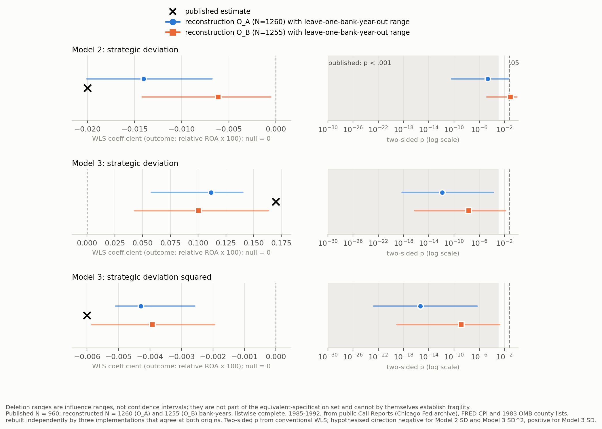

# Replication report: Deephouse (1999), "To be different, or to be the same?"

Study deephouse1999. Strategic Management Journal 20(2): 147-166. Coordinator session e8c50fbe-47ce-48c1-8aa1-bd531593c98a, 27 October 2026.

## Findings and scope

The paper-level outcome is indeterminate. The primary focal claim (H3, strategic balance: a concave relation between strategic deviation and relative ROA, Table 2 Model 3) is indeterminate because the reconstructed first-order strategic-deviation term lies outside the frozen magnitude band at both reader origins while the reconstructed sample is 31 percent larger than the published one. The secondary focal claim (H2, conformity: negative linear term, Model 2) is indeterminate because it reproduces at one reader origin and not at the other. No claim is classified as discrepant: every discrepancy candidate falls to indeterminate under the frozen sample-size rule, and no human confirmation of a discrepancy has been requested.

What did reproduce, from public Call Report data rebuilt independently by three implementations that agree to about 1e-13:

- The curvature term itself. The Model 3 coefficient on strategic deviation squared is negative and significant at p < .001 at both origins (published -0.006, SE 0.001; reconstructed -0.0043 and -0.0039), within 0.8 and 1.0 published standard errors.
- The sign and significance pattern of Model 3 (positive first-order term, negative squared term) and the F tests showing that adding the squared term improves fit over Models 1 and 2 (p < .001 at both origins).
- The robustness model without the first-order term (published -0.001, SE 0.0001; reconstructed -0.00064 and -0.00037, both significant).
- Most Model 1 and Model 2 controls.

What did not: the Model 3 first-order term is smaller (0.112 and 0.100 against 0.170, 3.3 and 4.0 published SEs away), so the reconstructed curve is about 30 percent flatter with a turning point near 13 rather than 14; the Model 3 expense-ratio coefficient (about -6 to -7 against -15.4) and intercept differ; the Model 2 linear term is p = .088 at one origin.

Scope limits. Reconstructed N is 1,260 and 1,255 bank-years against 960 published. A post hoc audit diagnostic suggests the frozen market definition (the 1983 OMB metropolitan area, including four outer counties) is broader than the author's; this diagnostic is not part of the scored results (see Limitations). Two further sensitivities, both labelled non-equivalent before execution, matter for interpretation: with bank-clustered standard errors the Model 3 squared term is p = .075 and .155, and unweighted OLS reverses its sign.

## Data and construction

All empirical inputs were acquired afresh from public providers on 27 October 2026 (provenance, hashes and failed attempts: registry/source_registry.json; acquisition log: logs/source_acquisition_log.md).

- Federal Reserve Bank of Chicago commercial bank Call Report archive, all 41 quarterly files 1983Q4-1993Q4 (national), and the Federal Reserve MDRM item dictionary.
- FDIC BankFind API: institutions, structure-change history and financials for Minnesota and Wisconsin.
- FRED/ALFRED and BLS price indexes (CPI-U national and Minneapolis-St. Paul, GDP deflator vintages).
- Census/OMB metropolitan-area county definitions (1981, 1983, 1990, 1993, 1999).
- Not obtained: the FFIEC National Information Center bulk download (CAPTCHA, not bypassed) and BLS flat files (HTTP 403; the same series came from the BLS API and FRED).

No author replication package exists (logs/supplement_and_package_search.json); the publisher page lists no supporting information and Crossref no corrections. Printed article values (Table 1 moments and correlations) were never used as inputs.

Variables were built from the regulatory items: relative ROA (net income over the mean of quarterly RC-K average assets, minus the unweighted market mean, x100), its one-year lag, strategic deviation (sum over eleven asset-share categories of absolute z-scores against the market mean and SD), its square, deposit market share, total expense ratio and real growth of market deposits. Estimation is WLS with market-share weights on bank-years 1985-1992, deleting Norwest Bank Minneapolis in 1987 (RSSD 995151) as the article does.

## Published versus reconstructed focal estimates

Two origins exist because the readers chose different default codings (see Reader agreement). Reconstructed values are identical across implementations A, B and C at both origins. Two-sided p from conventional WLS.

| Model, term | Published (SE) | O_A estimate (SE), p | O_B estimate (SE), p | Term outcome O_A / O_B |
| --- | --- | --- | --- | --- |
| M2, strategic deviation | -0.020 (0.004) *** | -0.0140 (0.0033), 2e-5 | -0.0061 (0.0036), 0.088 | consistent / discrepancy candidate |
| M3, strategic deviation | 0.170 (0.017) *** | 0.1116 (0.0156), 1e-12 | 0.1003 (0.0178), 2e-8 | discrepancy candidate (magnitude 3.3 SE) / discrepancy candidate (4.0 SE) |
| M3, strategic deviation squared | -0.006 (0.001) *** | -0.0043 (0.0005), 4e-16 | -0.0039 (0.0006), 1e-9 | consistent / consistent |
| M3 without first-order term, squared | -0.001 (0.0001), "significant" | -0.00064 (0.00011), 6e-9 | -0.00037 (0.00013), 0.004 | consistent / consistent |
| F test M3 vs M2 | 134.1, p < .001 | 67.8, p = 4e-16 | 37.3, p = 1e-9 | significance agrees |
| N | 960 | 1,260 | 1,255 | outside tolerance (+31%) |

Claim-level outcomes (scoring/run_v1/claim_outcomes.csv):

- H3 strategic balance (primary focal; Model 3 SD^2 and SD scored jointly): indeterminate, reason codes sample_construction_N_outside_tolerance and discrepancy_not_confirmed.
- H2 conformity over H1 differentiation (secondary focal): indeterminate, origin_label_sensitive.
- Model 3 without first-order term (robustness): consistent, with an N coverage qualification.
- Controls: 7 of 15 consistent (with coverage qualification); Model 3 expense ratio and intercept indeterminate after discrepancy candidacy (the intercept is also label-sensitive: 3 uncertain readings are consistent); 6 others indeterminate (5 origin label-sensitive, 1 grey zone).
- F tests: M3 vs M1 and M3 vs M2 consistent; M2 vs M1 indeterminate (origin label-sensitive).

Paper-level outcome under the frozen aggregation rule (the primary focal claim decides; indeterminate focal evidence makes the paper indeterminate): indeterminate. Fragility: not assessed, because the readers' only equivalent alternatives were algebraic re-expressions. Fragile inference: not assessable, because no assignment-level clustering applies and no alternative benchmark was declared.

## Figure: public-source reconstruction and influence checks

Left: published WLS coefficient (cross), reconstructed coefficient at each origin (dot or square) and the minimum-to-maximum coefficient over all leave-one-bank-year-out refits (line); outcome is relative ROA x 100, null value 0. Right: reconstructed two-sided p and the full range of deletion p values on a log scale; the shaded region is the published inequality p < .001 and the dashed line is .05. Values: reports/figure_reconstruction_influence.csv; script: reports/make_figure.py; vector: reports/figure_reconstruction_influence.svg.

What it supports: the squared term stays negative and below p = .05 in every one of 1,260 and 1,255 single-row deletions, and the Model 3 first-order term stays positive and significant; the deletion range for the squared term reaches the published value only at O_B, and no deletion brings the Model 3 first-order term up to its published value (closest: 0.163 at O_B). What it cannot establish: deletion ranges are influence ranges, not confidence intervals, and are not equivalent specifications, so the figure cannot show fragility. Whole-bank deletion (secondary diagnostic) is more severe: dropping one bank (First Bank, about 30 percent of the WLS weight) removes the O_A curvature result (p = 0.47), and Model 2 at O_B crosses .05 in nearly every deletion because its full-sample p is already .088.

## One worked example: the Model 3 squared term

The article states Hypothesis 3 (DOC01 p10) and the Model 3 equation (p11) and prints the coefficient -0.006 (0.001) *** in Table 2 (p12). Both readers transcribed it identically and mapped the eleven asset categories (p9-10) to Call Report items. They disagreed on what "other assets" means: Reader A summed the remaining balance-sheet lines (RCFD2150+2130+2155+2143+2160), Reader B used the literal other-assets line (RCFD2160). The reconciliation rules kept both as alternative origins (grid axis R14). The implementers, who never saw the article or any target, coded both; A, B and C produced the same sample hash and coefficients (-0.004292 at O_A) to 1e-13. The frozen scorer placed the estimate 0.81 published SEs from the rounding interval of -0.006, with matching sign and p band, so the term is consistent at both origins. Because the frozen rule scores H3 jointly with the first-order term, which falls 3.3-4.0 SEs away, and because N is outside tolerance, the claim outcome is indeterminate.

## Counts of model settings and refits

Per implementation (identical counts across A, B and C): 164 specification ids, of which 52 are duplicates of an origin level (recorded, not refitted). The 112 fitted settings are 2 origins, 84 uncertain one-at-a-time deviations (74 uncertain levels plus 10 levels that are the other reader's origin choice), 22 non-equivalent sensitivity settings and 4 algebraic checks; each with four models (446 fitted models plus 2 not-applicable centred checks). After removing identical realized samples and estimates, the uncertain set has 72 distinct settings per focal term. Algebraic checks (weight rescaling, centred polynomial) reproduce the origins exactly and are not counted as alternatives. Influence: 5,030 leave-one-bank-year-out and 780 leave-one-bank-out refits per implementation, no failures.

Uncertain-set dispersion (72 distinct settings; separate from the formal outcome):

| Term | Share with published sign | Share p < .05 in hypothesised direction | Median | Min to max | Published |
| --- | --- | --- | --- | --- | --- |
| M2 SD | 1.00 | 0.67 | -0.012 | -0.093 to -0.002 | -0.020 |
| M3 SD | 0.99 | 0.96 | 0.106 | -0.014 to 0.238 | 0.170 |
| M3 SD^2 | 0.99 | 0.97 | -0.0041 | -0.0090 to 0.0002 | -0.006 |

Non-equivalent settings (18 distinct) are reported separately in reports/exports/multiverse_summary.csv; notably unweighted OLS gives a convex fit and bank-clustered SEs make the curvature term non-significant.

## Readers, reconciliation and implementations

Readers (separate CLI processes, neutral staging folders, identical frozen packet and source descriptions): Reader A claude-fable-5-1, High effort, fast mode off (model confirmed by CLI metadata); Reader B gpt-6-astra, High effort, default service tier, fast mode off (codex exec does not report the model or effort; the CLI accepted the requested model). Title-only memorization probes, sealed before reading, showed both models knew the design and the qualitative inverted-U result but no coefficients or N.

Initial agreement, before any reconciliation (reconciliation/initial_agreement.json): claim tiers 14/17 matched claims (raw 0.82, Gwet AC1 0.78); claim directions 12/17 (0.71, AC1 0.64); specification labels 25/31 matched levels (0.81, AC1 0.76). Transcription of Table 2 and the text statistics agreed exactly. The readers disagreed on five origin choices (bank record filter, average-asset quarter coverage, other-assets definition, missing-item treatment, domestic versus consolidated deposits), which the frozen rules kept as two origins; three label disagreements became uncertain; weight rescaling and centring were reclassified as algebraic checks. Decisions: reconciliation/decisions_v1.md.

Implementations: A claude-fable-5-1 in R; B gpt-6-astra in R; C gpt-6-astra in Python 3.13. Each saw only the target-free manifest, data and dictionary. Pre-execution checkers from the other family returned unmet items over up to three rounds; one manifest clarification (v1.1, issued to all implementers before any fit) settled ambiguities. B and C ended with no unmet items; A was frozen with seven open checker items affecting only non-origin levels (checks/open_checker_items_at_freeze.md). Execution ran under a macOS sandbox denying network access and writes outside the run folder. Agreement: all three identical at both origins; B and C agree on all 164 settings; A differs on two levels (pro-forma merger lags, explicit loan components), which were scored on the B-C pair and audited.

## Audit and adversarial review

An auditor (Anthropic model, coordinator subagent) re-checked transcription against the page image, traced three bank-years from raw files, re-estimated all origin models and rebuilt the O_A sample from the extract (exact), confirmed completeness and re-derived every scored outcome (checks/audit_v1/audit_report.md). It found one scorer scope error: the label-sensitivity check was applied only to focal and robustness claims; the corrected scorer (v1.1; v1 outputs preserved as *_v1_superseded) adds a label-sensitive code to the Model 3 intercept and changes no outcome. The adversarial pass found no transcription, coding, unit or definition error behind any discrepancy candidate; the Model 3 intercept gap is explained arithmetically by the slope gaps, the H2 gap by the other-assets coding, and the H3 and expense-ratio gaps remain unresolved and consistent with a sample-construction difference. No model family independent of both implementer families was available, so a discrepancy could not have been fully verified in any case.

## Supplements

None. The publication packet (sources/publication_packet.json, v1) contains only the main article (DOC01, 20 pages, SHA-256 62eecc5b...). No local supplement, no publisher supporting information and no correction were found after a documented search. Gap: estimates with the eleven asset-strategy controls are described as available from the author (DOC01 p10-11) and are not public. No redactions or embedded code.

## Limitations

- Sample construction. N is 31 percent above the published value at both origins and across every grid setting except one degenerate variant. A post hoc audit diagnostic restricted the market to the seven-county Twin Cities area: it gives N = 974 and exactly 159 banks (the article's count, not used to choose the restriction), with market-share moments matching Table 1, Model 2 consistent, the Model 3 first-order term in the grey zone (2.4 SE) and the Model 3 expense ratio and intercept still different. Because it was chosen after results were seen, it is descriptive only and does not enter any outcome (checks/audit_v1/a7d_posthoc_7county_summary.json). A seven-county market level could only be evaluated as a separately versioned, pre-registered amendment.
- Weight concentration. Market-share weights put about 57 percent of the weight on three banks, so results depend on a few institutions; this is a property of the published design.
- Calibration. Scoring constants are provisional and uncalibrated; no corpus calibration, human double-coding or human-reproduced comparison was performed (outside this session).
- Isolation. Codex roles ran with network disabled; Claude roles relied on tool lists and instructions for network isolation. Frozen execution was sandboxed. Reads were not technically restricted.
- Independence. The coordinator, Reader A, implementer A, three checkers and the auditor are Anthropic models; Reader B, implementers B and C and one checker are OpenAI models.
- Privacy note. Eight early data-acquisition requests carried the user's account handle in the User-Agent string.

Technical details: reports/technical_supplement.md. Machine-readable outputs: reports/exports/.
