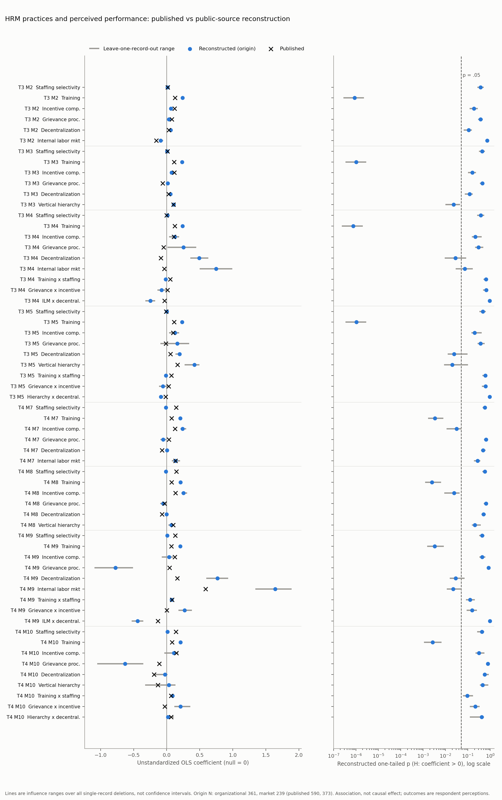

# Replication report: Delaney and Huselid (1996)

Delaney, J. T., and Huselid, M. A. (1996). The Impact of Human Resource Management Practices on Perceptions of Organizational Performance. Academy of Management Journal, 39(4), 949-969. Study ID delaney1996. Coordinator session b5dfe2d8-6c78-49e5-9b2d-f3b29045f21f, 2026-10-28.

## Findings

The paper-level outcome under the frozen protocol is indeterminate. Both focal claims are indeterminate (H1: progressive HRM practices are positively associated with perceived performance; H2: complementarities among practices). The main reason is sample reconstruction. The frozen origin specification yields 361 organizations for perceived organizational performance and 239 for perceived market performance, against 590 and 373 printed in the article. No specification in the frozen grid exceeded 372 and 250.

Within that smaller sample, three practices behave differently:
- Training is positively associated with both outcomes and is about twice the published size (for example 0.239 vs 0.125 in Table 3 model 2).
- Incentive compensation is positive but not significant for organizational performance.
- Staffing selectivity is near zero for market performance, where the article reports 0.145 to 0.147 at p < .01.

The scorer flagged 23 cells as discrepancy candidates, 4 of them among the 10 primary H1 cells. An adversarial review overturned 16 and left 7 uncertain, so none survives as evidence of an error in the article. Human confirmation has not been given.

The review traced most of the sample shortfall to three missing-data choices the article does not document:
- staffing items skipped for establishments that did not hire from outside;
- managers of the same occupation as the core or GSS group;
- competition coded "not applicable", mostly nonprofits.

One of the three is my own reconciliation error. Reader A's origin level for percent managers, which keeps those establishments, was logged as an origin but never executed. A post-hoc exploration that relaxes these three choices reaches N = 584 and 373. It moves several estimates toward the published ones (organizational incentive compensation 0.120; market staffing selectivity 0.119-0.122). That configuration was found after seeing results, partly by matching sample size, so it is reported only as a diagnostic and does not change any frozen classification.

What is being estimated is an association between practices reported by one informant and that informant's perception of performance relative to competitors. The data are cross-sectional and the article itself disclaims causal attribution (D1 p19). Nothing here supports a causal reading.

## What was reconstructed and from what

- Data: National Organizations Survey 1991, ICPSR 6240 V1, DS0002 SPSS portable file, 727 records x 1,016 variables.
  - The user downloaded it from ICPSR by hand; download time unknown; terms accepted 2026-10-27. No agent downloaded it or logged in to ICPSR.
  - A fresh source-role agent validated it:
    - all six files match the setup inventory and the ICPSR manifest MD5s;
    - an independent .por parser and haven::read_por agree on all 738,632 cells;
    - the unit is the establishment interview record.
  - Not supplied, and not needed: DS0001 (fixed-width ASCII version). The manifest lists a description PDF; the bundle has the HTML version.
  - Details: [registry/source_registry.json](../registry/source_registry.json), [registry/coverage_audit.md](../registry/coverage_audit.md).
- Newly acquired: the release has no SIC code, only 1980 Census industry codes. The source role downloaded three U.S. Census Bureau documents from census.gov. The 1980 industry list with 1972 SIC equivalents was transcribed by OCR, with corrections checked against page images ([data/derived/census1980_ind_sic1972_v1/](../data/derived/census1980_ind_sic1972_v1/README.md)). The mapping the authors used, and their 33-dummy industry grouping, are unknown. The reconstruction entered 54 industry dummies (55 groups) in the organizational sample and 47 in the market sample.
- Not used: printed data from the article (Table 1 item means, Table 2 means, SDs and correlations). Published values served only as sealed comparison targets.
- No author replication package was found ([logs/eligibility/package_and_supplement_search.json](../logs/eligibility/package_and_supplement_search.json)).

All 22 reported regressions were reconstructed for each outcome family, along with the HRM-block and interaction-block F tests. The unshown complementarity count, threshold and spline models and the for-profit/nonprofit subgroup analyses were not attemptable, because the article prints no estimates for them.

## Published versus reconstructed focal estimates

Frozen origin specification, implementations A and B (identical to 1e-12). N = 361 (organizational) and 239 (market). Tests are one-tailed in the hypothesized positive direction, as in the article.

| Cell (H1 primary) | Published coef (SE) | Reconstructed coef (SE), p | Uncertain-branch range (34 specs) | Frozen cell outcome |
|---|---|---|---|---|
| T3 M2 Training | 0.125** (0.041) | 0.239 (0.049), p < .001 | 0.103 to 0.888 | indeterminate, label-sensitive |
| T3 M2 Incentive | 0.120** (0.048) | 0.065 (0.073), p = .19 | -0.060 to 0.085 | discrepant candidate; overturned on review |
| T3 M3 Training | 0.111** (0.040) | 0.234 (0.048), p < .001 | 0.103 to 0.889 | indeterminate, label-sensitive |
| T3 M3 Incentive | 0.117** (0.048) | 0.073 (0.073), p = .16 | -0.062 to 0.094 | discrepant candidate; overturned on review |
| T3 M3 Vertical hierarchy | 0.103* (0.051) | 0.107 (0.053), p = .023 | 0.004 to 0.119 | indeterminate, sample size |
| T4 M7 Staffing | 0.145** (0.057) | -0.013 (0.062), p = .58 | -0.197 to 0.028 | discrepant candidate; uncertain on review |
| T4 M7 Incentive | 0.125† (0.081) | 0.239 (0.128), p = .031 | 0.203 to 0.770 | indeterminate, sample size |
| T4 M8 Staffing | 0.147** (0.057) | -0.011 (0.062), p = .57 | -0.196 to 0.020 | discrepant candidate; uncertain on review |
| T4 M8 Training | 0.076* (0.058) | 0.211 (0.074), p = .002 | 0.093 to 0.254 | indeterminate, label-sensitive |
| T4 M8 Incentive | 0.134* (0.081) | 0.253 (0.128), p = .025 | 0.225 to 0.998 | indeterminate, sample size |

† p < .10, * p < .05, ** p < .01, one-tailed.

H2 is assessed through the four interaction-block F tests:
- Published (T3 M4, M5; T4 M9, M10): 0.445, 0.868, 0.640, 0.665.
- Reconstructed: 1.20 (p = .31), 0.98 (p = .40), 1.89 (p = .13), 0.81 (p = .49).

Both published and reconstructed are non-significant, but each cell is indeterminate because of the sample-size criterion. The HRM-block F tests are diagnostic cells:
- Published 3.582**, 3.953*, 2.703*, 2.489*.
- Reconstructed 4.79 (p < .001), 5.44 (p < .001), 2.18 (p = .047), 2.24 (p = .042).

Every cell, including controls and the single-practice models, is in [data/claim_cell_comparisons.csv](data/claim_cell_comparisons.csv).

## Classification

Claim level:
- H1 is indeterminate. The scorer's reason: label sensitivity and sample reconstruction, with 6 of 10 primary cells indeterminate and 4 discrepancy candidates. The rule needs at least 6 discrepant cells for an H1 discrepancy.
- H2 is indeterminate: all 4 primary cells are indeterminate on sample reconstruction.

Paper level: indeterminate. Sub-codes: sample_reconstruction (undocumented missing-data and routing rules) and label_sensitive.

Fragile and fragile-inference verdicts were not assessed in the usual sense:
- No substantive equivalent alternative survived reconciliation, so specification fragility is not assessed.
- No cell reached the fragile-inference rule, because the sample-size criterion applies first. HC3 benchmark p values (a declared adaptation, since there are no clusters) are reported for every coefficient in [data/specification_results_all_implementations.csv](data/specification_results_all_implementations.csv).

The 23 discrepancy candidates are recorded as "discrepant_candidate_pending_human_review". The adversarial reviewer recommends that a human reviewer not confirm any of them, for these reasons:
- Incentive compensation (Table 3): the reconstructed SE is 1.5 times the published one, so the significance band fires even though the estimate lies within about one published SE.
- Staffing selectivity (Table 4): a real disagreement under every frozen reading, but it appears to come from construction rather than an article error.
- Subsidiary: Table 2 shows the authors coded it in the opposite direction.
- Seven cells: flagged only because a near-zero printed estimate changed sign.

No human review has taken place. No discrepant verdict is claimed.

## One path from text to score

1. Article text (D1 p7): training is "a 3-item index" of whether formal training was provided, how many employees were trained and its effectiveness, "standardized and averaged". Table 1 footnote b (D1 p10) adds "standard score of logged value for all".
2. Readers:
   - Reader A (Fable 5.1) took the footnote as origin (log all three items).
   - Reader B (GPT-6 Astra) took the text (no logs).
   - They also disagreed on establishments without training: A assigned zero participants and the lowest effectiveness; B left the skipped items missing.
3. Reconciliation (rules_v1): the more specific footnote set the working origin for the logs. The no-imputation rule set the origin for no-training establishments. Each reader's other level became an uncertain branch (D12-D15).
4. Implementation: three implementers built TRAIN from V145, V157 and V172 under the neutral spec, with no access to the article or targets. A and B agree to 1e-12.
5. Execution: in sandboxed runs with network denied, TRAIN in T3 M2 is 0.239 (SE 0.049); across the 34 uncertain specs it ranges 0.103 to 0.888.
6. Scoring: the magnitude distance is 2.77 published SEs, beyond the 2-SE threshold. But 5 uncertain specs fall within tolerance, so the cell is indeterminate (label-sensitive) rather than discrepant.

## Counts

| Item | Count |
|---|---|
| Grid specifications | 38: origin + 34 single-axis uncertain deviations + 3 algebraic checks |
| Fits per implementation | 912 model fits (24 per spec) and 304 nested tests |
| Failed fits | 2 (market models 9 and 10 in the publicly-held subsample: a collinear interaction with N = 69) |
| Distinct substantive specifications | 35 (the 3 algebraic checks confirm invariance exactly and are not alternatives) |
| Equivalent alternatives | 0 |
| Uncertain alternatives | 34 |
| Non-equivalent alternatives | recorded but not executed |
| Repeat implementations | 3 executions of the grid (A, B, C); not additional alternatives |
| Leave-one-record-out refits | 2,400 per implementation over the eight multi-practice models at origin; 18,000 coefficient rows, all fits successful |

## Figure

Files: [SVG](figures/reconstruction_influence.svg), [PNG](figures/reconstruction_influence.png), [CSV](figures/reconstruction_influence.csv), [script](scripts/make_figure.py).

Rows are every HRM-practice and interaction coefficient in Table 3 models 2-5 and Table 4 models 7-10, in the article's order.
- Left panel: unstandardized OLS coefficient (null = 0). Published values are crosses, reconstructed origin estimates are dots, and the line spans the minimum to maximum over all single-record deletions.
- Right panel: reconstructed one-tailed p (H: coefficient > 0) with its deletion range, on a log scale; the dashed line is p = .05.
- Samples: N = 361 (Table 3 models), N = 239 (Table 4 models). Complete cases within each outcome family under the frozen origin rules.
- Source: NOS 1991 (ICPSR 6240, user-supplied), with variables built independently from the neutral manifest.

What the figure shows: no single establishment drives the main gaps. Training stays well above its published value in every deletion. Incentive compensation (organizational) and staffing selectivity (market) never reach their published values under any deletion.

What it cannot show:
- The deletion ranges are influence ranges, not confidence intervals.
- They are not part of any equivalence set.
- The figure by itself cannot establish fragility or discrepancy.
- Coefficients for different practices are on different scales, so the rows are not comparable to each other.

## Readers, reconciliation and configurations

| Comparison | Agreement | Denominator | Gwet's AC1 |
|---|---|---|---|
| Claim tiers | 60% | 15 matched content units | 0.51 |
| Specification labels | 54% | 46 matched levels | 0.42 |
| Regression-table transcription | 191 of 192 cells | 192 | not applicable |

Further detail:
- Unmatched claims: 1 Reader A-only and 7 Reader B-only.
- Single-reader specification levels: 11 from Reader A and 25 from Reader B.
- The one transcription difference (Table 3 model 3 joint F star) was resolved from the D1 page image.
- No clarification round was used.

The full ledger and the coordinator's decisions are in [reconciliation/decisions_v1.md](../reconciliation/decisions_v1.md). Known reconciliation error: Reader A's origin level for percent managers (A15.L0) was paired with Reader B's origin and never executed.

| Role | Model | CLI |
|---|---|---|
| Coordinator | claude-opus-5-5, high effort, fast off (per settings; /status not observable) | Claude Code desktop |
| Reader A, probe A | claude-fable-5-1, high, standard speed (verified in run metadata) | claude 2.1.270 --safe-mode |
| Reader B, probe B | gpt-6-astra, reasoning high, default tier (accepted by CLI; model not echoed) | codex-cli 0.164.0 |
| Implementer A (R) | claude-fable-5-1 (verified; versions v1, v1.1, v1.2) | claude |
| Implementer B (R) | gpt-6-astra (versions v1, v1.1) | codex |
| Implementer C (Python) | claude-fable-5-1 (verified; v1, v1.1, v1.2 third attempt) | claude |
| Pre-execution checkers | gpt-6-astra for A and C; claude-fable-5-1 for B | codex / claude |
| Source role, code audit, adversarial review | coordinator subagents (Opus family) | Claude Code |

Notes on verification:
- Two attempts at implementer C's v1.2 repair silently ran on claude-opus-4-8 although claude-fable-5-1 was requested. Both were rejected and preserved. The accepted attempt used `--fallback-model claude-fable-5-1` and is verified.
- Codex loads the user's global AGENTS.md (Python path, Markdown math and Gmail rules) despite `--ignore-user-config`.
- Coordinator and Reader A share the Anthropic family; the coordinator did not read independently.
- See [logs/role_run_model_verification.json](../logs/role_run_model_verification.json).

Implementation agreement:
- A and B agree on all 38 specs: identical samples, coefficients within 2.4e-12. One D02 flag is a formatting artifact of the failed models ([note](../checks/audit/implementation_agreement_note_AB.md)).
- C uses identical samples but differs because of one record, which has an unlabelled code 0 on V233. C reversed it into an out-of-range value; A and B treat it as missing, which follows the spec. Correcting that value makes C match A to 1e-11 ([audit](../checks/audit/C_divergence/AUDIT.md)).
- Scoring used the agreeing A-B pair.
- Isolation:
  - Readers, implementers and checkers ran from neutral temporary directories with no access to the article (implementers) or targets.
  - Frozen runs executed under sandbox-exec with network denied and writes restricted.
  - Isolation of reader and implementer file reads rested on instructions only.

## Supplements and the publication packet

No supplement, appendix or correction was found.
- Crossref lists no updates.
- The publisher page returned HTTP 403.
- The local supplement catalog has no match.

The packet ([readers/publication_packet.json](../readers/publication_packet.json)) contains:
- D1: the journal print scan from the shared library. Its text layer is clipped, so readers used page images.
- D2: the author-hosted retypeset copy (markhuselid.com, created 1997-02-17).

D1/D2 contradictions were retained, D1 governing. Examples:
- Table 4 model 7 incentive SE: 0.081 in D1, 0.061 in D2.
- Several Table 2 cells.

Contradictions within the article, found by both readers:
- Firm age is described in years but labelled log in every table.
- Competition is described as 1-4, but Table 2 prints mean .44 and SD .50.
- The market sample is "profit-making" in the text and "publicly held" in Table 1.
- Training is "standardized and averaged" in the text but "logged" in the footnote.
- The printed stars disagree with the coefficient/SE pairs for several cells.

Unpublished material referred to in the article: subgroup analyses "available upon request" and complementarity models "not shown". Both are unavailable.

## Limitations

- The article gives no missing-data, routing or sample-construction rules, so the analysis sample cannot be identified from the text. This is the dominant limitation.
- The two-digit SIC grouping is unknown. Census-to-SIC mapping is ambiguous for six Census codes.
- The scoring constants are provisional and uncalibrated. The sign criterion fires on near-zero printed estimates.
- Scorer application issues found by the reviewer, none of which changes a claim outcome:
  - the N cells for models 1 and 6 are marked not attemptable instead of descriptive;
  - the direction rule for two non-significant controls was applied incorrectly.
- The adversarial review was run by the same model family as implementations A and C, so the independent-family requirement is not met. Human confirmation is pending.
- Calibration arms (planted errors, null data, human-reproduced sets) were not performed.
- Total Claude CLI role cost recorded: $76.76. The Codex usage cost is not reported.
- Data and terms: ICPSR terms prohibit redistribution. Derived record-level files stay inside this study. Two temporary full-data CSVs and codebook extractions remain in the session scratchpad because deletion was not permitted to agents; the user should delete them.

Technical detail is in [technical_supplement.md](technical_supplement.md).
