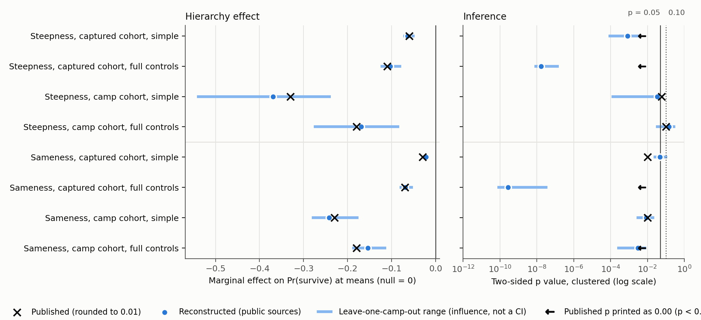

# Replication report: Holderness and Pontiff (2012)

Holderness, C. G. and J. Pontiff (2012). Hierarchies and the survival of prisoners of war during World War II. Management Science 58(10): 1873-1886. Study holderness2012, coordinator session fd5c105f-e59a-44db-b474-6f14aa01b1e0, 27 to 28 October 2026.

## Findings

The article's focal result reproduces from independently acquired public records. In all eight Table 4 probit models the reconstructed marginal effect of hierarchy on survival is negative, and its inference band is the published band, an adjacent band or a stronger one. Under the frozen rules each of the four focal claims (Steepness and Sameness of the hierarchy, measured over captured cohorts and over camps) is consistent. The paper-level outcome is partially reproduced. One lower-tier coefficient and three text-only robustness statements are not reproduced; they survived an adversarial review. They are discrepant but not fully verified, because the adversarial review was run by a model from the same family as one implementation.

Three qualifications apply to the focal result. The magnitude criterion could not be audited, because the article prints p values but no standard errors. Specification fragility was not assessed, because the two readers agreed on no substantive equivalent alternative. The two Sameness claims are label-sensitive: of 19 uncertain one-at-a-time alternatives, two move a Sameness coefficient above p = 0.10 (strict rank labels for the captured-cohort simple model; group composition from complete-covariate members only for both camp-cohort models).

## What was reconstructed and from what

Both of the article's data sources were downloaded afresh from the U.S. National Archives catalog: the World War II Prisoners of War Data File (Record Group 389, NAID 1263907; 143,374 records; hash matches NARA's published SHA-256) and the Electronic Army Serial Number Merged File of World War II Army enlistment records (Record Group 64, NAID 1263923; 9,200,232 records). Records were linked by serial number. Camp locations for the distance-to-capital control were geocoded independently from the NARA camp code list with the GeoNames gazetteer. Nine-rank coding was built mechanically from the readers' rules and the NARA grade code meanings (registry/manifest_tables/). No observation, correlation matrix or summary statistic from the article was used as input. No author replication package, supplement, appendix or correction exists to our documented search; three earlier working-paper versions were identified and excluded from the publication packet.

The reconstructed sample: 124,387 U.S. military prisoners held by Germany or Japan with known fate (the article's Table 1 reports 122,765), of whom 101,993 have a usable camp and report month. Captured-cohort models with camp fixed effects drop 178 camps (1,321 prisoners) without outcome variation, leaving 100,672. The article reports 100,464 for all eight Table 4 columns (our N is 0.2 percent higher for captured-cohort and 1.5 percent higher for camp-cohort models; the adversarial review traced the camp-model gap to our manifest applying the perfect-prediction drop only to fixed-effect models). 56.5 percent of the regression sample links to an enlistment record (article: about 55 percent). Pseudo R2 of all eight Table 4 models are within 0.01 of the printed values.

Two article inputs could not be rebuilt exactly. The POW file has no capture date, so captured cohorts and length of captivity use the report month. No pay-grade table is available, so the pay-based Steepness variant and the pay interactions were not run.

## Focal estimates

Marginal effects on the probability of survival at the means of the regressors; p values two-sided, clustered by captured cohort or camp. Reconstructed values are from implementations A and B, which agree within tolerance (C in parentheses where it differs in the third decimal).

| Measure, group, specification | Published (p) | Reconstructed (p) | Leave-one-camp-out range | Outcome |
| --- | --- | --- | --- | --- |
| Steepness, captured cohort, simple | -0.06 (0.00) | -0.064 (0.001) | -0.074 to -0.048 | consistent |
| Steepness, captured cohort, full | -0.11 (0.00) | -0.103 (<0.001) | -0.125 to -0.079 | consistent |
| Steepness, camp, simple | -0.33 (0.06) | -0.369 (0.035) | -0.542 to -0.238 | consistent |
| Steepness, camp, full | -0.18 (0.10) | -0.169 (0.145) | -0.277 to -0.083 | consistent |
| Sameness, captured cohort, simple | -0.03 (0.01) | -0.022 (0.047) | -0.026 to -0.017 | consistent, label-sensitive |
| Sameness, captured cohort, full | -0.07 (0.00) | -0.069 (<0.001) | -0.082 to -0.052 | consistent |
| Sameness, camp, simple | -0.23 (0.01) | -0.242 (0.009) | -0.282 to -0.175 | consistent, label-sensitive |
| Sameness, camp, full | -0.18 (0.00) | -0.154 (0.003) | -0.190 to -0.112 | consistent, label-sensitive |

Claim level: all four focal claims are consistent. The Table 6 officer-by-hierarchy interaction, whose focal status the readers disputed, is also consistent in all eight columns (all negative, as printed), so the paper-level label is the same with or without it.

## Lower tiers

Twelve lower-tier entries meet the formal sign rule after scoring. All are coefficients whose printed and reconstructed values are both far from significance (p 0.41 to 0.96). Eight are length-of-captivity and linear group-size controls (four in Table 4, four in Table 6); for the four Table 4 entries at least one frozen uncertain alternative reproduces the printed sign, the Table 6 entries share the same construction (branches were run on Table 4 models only), and all eight are classified indeterminate (label-sensitive). Three are the squared group-size term, which the adversarial review judged a probable scale artifact. One survives: the Table 5 Panel A camp-cohort simple Sameness coefficient (printed -0.01, p 0.95; reconstructed 0.039, p 0.84). Four nonsignificant published entries become significant at 0.10 in the reconstruction; per the frozen rule they are recorded as contradicting nonsignificance, not as failures (largest change: Table 5 Panel A captured-cohort simple Sameness, 0.27 to 0.04).

Text-only robustness statements (no published numbers) were compared descriptively. Consistent: Germany-only and Japan-only results, the friends (same-unit) control, the positive group-size term without its square, and the negative hierarchy sign in complete-data, minimum-cohort-size and no-execution subsets. Not reproduced and surviving review: hierarchy recomputed over same-unit members stays strongly negative (article: insignificant, p around 0.50); administrative intensity and sum of ranks are positive in camp models (article: all robustness coefficients negative); the ROC test for camp full Steepness gives 0.58 (article 0.00). Indeterminate: the hierarchy-by-size interaction (interpretation-sensitive), one ROC row (test-method sensitive: our DeLong fallback versus the article's Hanley-McNeil test), and the Air Force subsample (implementations read the group definition differently and the fits show quasi-separation).

## Figure

Left: published marginal effect (cross, rounded to 0.01), reconstructed effect (dot) and the range across all leave-one-camp-out refits (line), on the marginal-effect-on-Pr(survive) scale with null 0. Right: the corresponding two-sided clustered p values on a log scale with 0.05 and 0.10 marked; published "0.00" is drawn as an arrow at 0.005 (p < 0.005). Deletion ranges are influence ranges, not confidence intervals, and are not part of any equivalent-specification set. N = 100,672 (captured cohort) and 101,993 (camp); missing covariates set to zero with indicators, as the article describes. Implementation A ran all 2,016 deletions (none failed); B reproduced A to within 5e-6 on the 160 shared deletions. Data: reports/figure/reconstruction_influence.csv; script: reports/figure/make_figure.py; SVG and PNG alongside.

The figure supports two statements: no single camp drives the sign of any focal effect, and only the camp-cohort full Steepness effect has inference that depends on single camps (p 0.03 to 0.32, around a published value of 0.10). It cannot establish fragility or robustness in the protocol's sense, because there was no equivalent specification set to compare.

## How one estimate travelled through the pipeline

The article defines Steepness as an ordered Gini of rank values within a group (D1 p. 1877) and reports, in Table 4 column 2, -0.11 with p 0.00 for captured cohorts with full controls (D1 p. 1880). Both readers transcribed these values identically and wrote target-free manifests specifying the formula, the captured cohort (same camp, same month) and the control list; they disagreed on several coding details, which the coordinator kept as uncertain branches (for example, Reader B's strict rank-label reading). The frozen manifest gave implementers the formula, rank tables and the probit-at-means estimator with captured-cohort clustering, but no article identity or targets. In the sandboxed run, implementations A and B both returned -0.1034 (p 1.7e-8) on the same 100,672 records; C returned -0.1033. The scorer then opened the sealed target: the reconstruction lies 0.0016 outside the printed rounding interval [-0.115, -0.105] (magnitude not audited), has the same sign and the same p < 0.01 band, so the coefficient is consistent; all 19 uncertain branches stay below p 0.001, and all 163 single-camp deletions stay between -0.125 and -0.079.

## Counts

Per implementation: 266 model fits and 8 ROC comparisons. Of these, 8 are the focal origin fits (the whole equivalent set), 152 are one-at-a-time uncertain branches on the focal models (151 with an agreeing implementation pair; 50 are numerically identical to the origin because the changed parameter does not enter that model, leaving 101 distinct realized designs), 96 are reported non-equivalent robustness or table families (Tables 5 and 6 and 15 robustness families), and 10 are the friends-definition branch. Influence refits: 2,016 (A) and 160 each (B, C). Non-equivalent alternatives proposed by readers but not reported in the article (average marginal effects, penalized probit, difference-in-derivatives interaction) were not run. Repeat implementations are checks, not additional specifications.

## Readers, reconciliation and implementations

Readers: Claude Fable 5.1 (High, normal speed, claude CLI in safe mode) and GPT-6 Astra (High, default tier, codex CLI, no network), separate processes from neutral staging folders with an identical frozen packet. Initial agreement before any clarification: claim tier 21 of 27 matched pairs (Gwet's AC1 0.73), focal designation 26 of 27 (0.95), specification labels 10 of 11 (0.89), origin choice 5 of 7, transcription 248 of 248. No clarification round was used. The coordinator logged every disagreement (reconciliation/ledger_v1.md): label disagreements became uncertain, structural differences were kept as a union of 23 axes, and no alternative was labelled equivalent by both readers.

Implementations: A Claude Fable 5.1 in R, B GPT-6 Astra in R, C GPT-6 Astra in Python. Checkers found one genuine error (A's complete-case filter, fixed and rechecked) and one runtime bug (C's file naming for a camp code containing "/", repaired, rechecked and rerun). A and B agree on all 32 core terms and on the estimation rows of all 266 models; C agrees on 22 of 32 because the manifest's wording on spaces inside grade labels allowed two readings (708 records), so scoring uses A and B. All numerical runs executed in a macOS sandbox without network access or read access to the project folder.

Memorization probes, run before reading and sealed: Fable 5.1 recalled the citation but stated the findings with the opposite sign and no numbers; GPT-6 Astra recalled nothing substantive. There is no sign that reported numbers were memorized.

## Supplements and packet

The packet contains only D1, the published article (JSTOR scan, sha256 57d70148...0fdbb4). The local supplement catalog has no entry; a documented search of the publisher, Crossref, DataCite, data repositories and the authors' pages found no supplement, e-companion, correction or replication package. No redactions. Gap: results the article reports only as "in previous versions of the paper" (Germany and Japan separately, the Air Force subsample) have no published numbers; working-paper versions exist but were excluded as outside the published record. No contradiction between main text and supplements can arise. Readers noted one internal inconsistency: Table 6 reports N = 102,334 under the same sample description as Table 4 (N = 100,464).

## Limitations

- Magnitude agreement is unaudited (no published standard errors); reconstructed focal effects differ from printed two-decimal values by up to 26 percent in relative terms (captured simple Sameness -0.022 against -0.03; camp full Sameness -0.154 against -0.18), and only two of eight fall inside the printed rounding interval.
- Data vintage: same NARA files, but the article's download date and any later NARA reprocessing are unknown; the capture date is unavailable and report month substitutes for it.
- Scoring constants are provisional and uncalibrated. The scorer was corrected twice before reporting to match the frozen rule text (unconfirmed lower-tier flags; newly significant nonsignificant entries); no rule, label, tolerance or target changed, and all versions are preserved.
- Adversarial review used an Anthropic model, the same family as implementer A and Reader A; no fully verified discrepancy can be claimed. Corpus-level calibration is outside this session and was not performed.
- Raw files could not be write-protected (immutability rests on hashes); reader and implementer isolation beyond CLI sandboxing is instruction-based.

Details: reports/technical_supplement.md, reports/adversarial_review.md, scoring/final_classification.json, scoring/claim_scores.csv, logs/limitations_log.md.
