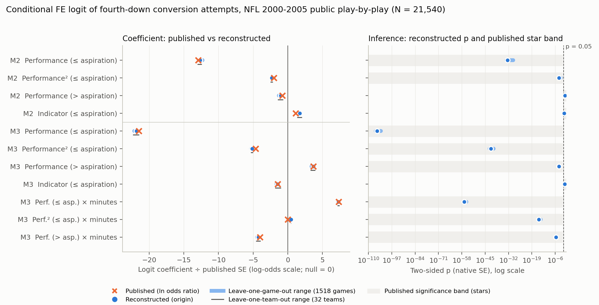

# Replication report: Lehman, Hahn, Ramanujam and Alge (2011)

Study lehman2011. Article: "The Dynamics of the Performance–Risk Relationship Within a Performance Period: The Moderating Role of Deadline Proximity", Organization Science 22(6): 1613-1630, doi:10.1287/orsc.1100.0626. Coordinator session 854f82b1-fa2c-409c-9663-ea33f56d31cd, 27-28 October 2026.

## Findings and scope

All four focal hypotheses (H1A, H1B, H2, H3) are classified consistent under the frozen protocol. The reconstruction used independently acquired public NFL play-by-play data.

- The focal Table 5 coefficients reproduce closely. The Model 3 interactions between performance and minutes remaining, which carry the article's central moderation claim, fall inside the published rounding intervals. Each has the same sign and the same p < 0.01 star band.
- Three independent implementations agree to about 1e-8, in R twice and in Python once. Two model families wrote them.
- All 191 uncertain-branch specifications classify every primary focal coefficient as consistent.
- No game, team or season deletion changes the sign or the 0.05 significance status of any focal coefficient.
- The game-clustered benchmark inference flags no case of fragile inference.

The paper-level outcome under the frozen aggregation rule is consistent. The comparability mapping is "partially reproduced". The mapping rests on two lower-tier cells.

- The two cells are the Model 1 same-division and same-conference controls. Both are nonsignificant in the article and in the reconstruction, and they are flagged only by the sign rule on odds ratios near 1.
- The adversarial review did not overturn them (verdict uncertain), and it found strong evidence that the article's Table 1 swaps these two labels.
- The accepted ruling confirms the mapping only. It does not make these cells fully verified discrepancies, because no independent model family was available for the adversarial review.
- Specification fragility was not assessed, because no alternative was labelled equivalent by both readers. This is not a claim of robustness.

Scope and limits:

- Public-source reconstruction. The article does not name its data source. We used the nflverse play-by-play releases (CC-BY-4.0), which are later builds of the NFL feed. Our analysis sample has 21,540 plays against the published 22,603, 4.7% fewer, which falls in the frozen "moderate" N band.
  - The difference arises before the two-minute exclusion: 22,766 regulation fourth-down decision plays against the published 23,965.
  - Two 2000 games are missing from the public play-by-play.
  - We cannot tell how much of the gap reflects the source vintage and how much reflects play-classification rules the article does not document.
- Secondary evidence is label-sensitive. The Table 6 marginal effects depend on how predicted probabilities are set after the fixed-effects logit.
  - Under the frozen origin convention (group effect set to zero), 8 of 35 cells are consistent and 18 are discrepancy candidates. All signs match, but the magnitudes are about 2-3 times larger.
  - Under the prespecified uncertain variant U9a (averaged over estimated team effects), 28 of 35 are consistent.
  - These are secondary targets and do not change claim outcomes.
- Discrepancy verification is incomplete. No model family independent of both implementation families was available for the adversarial review. No discrepant verdict is claimed.

## What was reconstructed and from which public sources

| Element | Status | Source |
|---|---|---|
| Fourth-down plays, scores, clock, field position, play type, 2000-2005 | acquired | nflverse-data release "pbp", play_by_play_2000-2005 (parquet and csv.gz), acquired 2026-10-27; three build vintages (nflfastR 5.0-5.2); sha256 in registry/source_registry.json |
| Game metadata: week, home team, venue, division-game flag | acquired | nflverse release "schedules" games.parquet, cross-checked with nflverse/nfldata games.csv (commit 20cdb994) |
| Season-specific conference and division of each team | constructed | nflverse/nfldata standings.csv (2002-2005) and 44 pinned English Wikipedia standings templates (2000-2001, CC BY-SA 4.0); agrees with the games file's div_game on all 1,520 games; registry/team_season_alignment.csv |
| Two 2000 regular-season games (2000_03_SD_KC, 2000_06_BUF_MIA) | unavailable | listed in the schedule but absent from both play-by-play vintages |
| Spread-based alternative reference point; field-goal-range submodels (narrative robustness in the article) | not attemptable | construction not documented in the article |

All samples and variables were built by the implementers from the raw files, following a target-free manifest. No printed article data were used as inputs.

## Published versus reconstructed focal estimates

The models are conditional (fixed-effects) logits grouped by offensive team, with season dummies. Odds ratios are shown with the published SE in parentheses. The reconstructed p is two-sided, with conventional ML standard errors. The benchmark is a game-clustered sandwich on the matched dummy-variable logit.

| Claim | Term | Published OR | Reconstructed OR | p (native) | p (benchmark) | Distance in published SEs | Outcome |
|---|---|---|---|---|---|---|---|
| H1A | M2 perf ≤ aspiration | 0.883** (0.008) | 0.885 | 3.4e-33 | 8.1e-32 | 0.20 | consistent |
| H1A | M2 perf² ≤ aspiration | 0.999** (0.000) | 0.9988 | 1.6e-4 | 3.6e-4 | 0.00 | consistent |
| H1B | M2 perf > aspiration | 0.994 (0.007) | 0.992 | 0.33 | 0.38 | 0.14 | consistent |
| H2 | M3 perf ≤ asp. × minutes | 1.011** (0.001) | 1.0109 | 2.4e-57 | 2.4e-50 | 0.00 | consistent |
| H2 | M3 perf² ≤ asp. × minutes | 1.000** (0.000) | 1.0002 | 7.0e-16 | 2.3e-15 | 0.00 | consistent |
| H3 | M3 perf > asp. × minutes | 0.998** (0.000) | 0.9979 | 3.3e-6 | 1.9e-5 | 0.00 | consistent |

N: the published N is 22,603 in every model; ours is 21,540 in every model. The published star key is +p<0.10, *p<0.05, **p<0.01, with the tail not stated; the frozen rule uses two-sided tests. Printed SEs of 0.000 are low resolution, so the magnitude check uses the upper rounding bound. H1B's published coefficient is nonsignificant, and the article reports H1B unsupported at the game level; the reconstruction agrees.

Claim-level and paper-level outcomes are recorded separately in reports/data/claim_and_paper_records.json. Each claim's secondary marginal-effect shares are given in the technical supplement.

## One worked example: H2

1. Article. Table 5, Model 3 (PDF p.11) prints the odds ratio for "Performance (≤ aspiration) × Minutes remaining" as 1.011** (0.001). The text (PDF p.12) tests H2 with that model and with marginal effects by quarter.
2. Readers. Both readers marked H2 focal. Both transcribed 1.011, 0.001 and **. Both defined performance as own score minus (opponent score + 1), split at zero, with minutes as regulation seconds remaining divided by 60 (PDF pp.8-9).
3. Frozen specification. The manifest defines perf_below = min(d, 0), minutes = game_seconds_remaining/60, and perf_below_x_min = perf_below × minutes. The origin estimator is the exact conditional logit by offensive team with season dummies. Sample: regular-season fourth-down punts, field goals, runs and passes in regulation, with more than 120 seconds remaining.
4. Execution. All three implementations returned 0.010855 (SE 0.000681, p = 2.4e-57) on the same 21,540-play sample.
5. Scoring. The published interval [1.0105, 1.0115] maps to [0.010445, 0.011434] on the log-odds scale. The estimate lies inside it, so the magnitude distance is 0. Both bands are p < 0.01, and the signs agree. The target is consistent, as are the other H2 primary target and all 191 uncertain branches, so H2 is consistent.

## Specifications fitted and influence refits

| Item | Count | Notes |
|---|---|---|
| Grid fits per implementation | 604 (A and B), 621 (C, including auxiliary benchmark fits) | 577 distinct model settings: 3 models × (1 origin + 8 single-axis deviations + 183 further crossings) + 1 M1-only deviation; 27 grid rows repeat earlier cells and are flagged duplicate_of |
| Distinct realised samples | 8 | the sample depends only on U1-U3 |
| Equivalent set | 0 | no level labelled equivalent by both readers, so fragility not assessed |
| Uncertain set | 191 non-origin cells per model | U1-U7 crossings; plus U8 for M1 |
| Non-equivalent runs | 9 fits (N1, N2, N4 × M1-M3), plus N3 average marginal effects | reported separately, not scored |
| Algebraic checks | 2 | K1: elapsed-minutes reparameterisation; K2: complemented home indicator; both identical to machine precision |
| Influence refits | 1,518 games, 32 teams and 6 seasons, each × M2 and M3 | game deletions in A and C, team and season in A, B and C; 11 benchmark failures in A (season 2000 deletion), none in C |

Equivalent, uncertain and non-equivalent alternatives are listed with their sources in the technical supplement. The duplicates and algebraic checks are not counted as alternatives.

## Figure: public-source reconstruction and influence checks

Rows: the focal performance terms of Models 2 and 3 in Table 5, in a fixed order registered before results. Left panel: logit coefficients divided by the published log-scale SE (upper rounding bound); null = 0. The published ln(odds ratio) is a cross and the reconstructed origin coefficient a dot. The thick line is the minimum-to-maximum range across all 1,518 leave-one-game-out refits; the thin line is the range across the 32 leave-one-team-out refits. Right panel: the reconstructed two-sided native p on a log scale, the game-deletion p range, the published star band shaded, and a 0.05 reference line; no p value underflowed.

N = 21,540 regular-season regulation fourth-down plays, 2000-2005, excluding the final two minutes. Missingness is complete-case; no rows were lost. Data are nflverse public play-by-play and schedules, with an independently built team-alignment table. Implementers built the measurements from a target-free manifest.

Deletion ranges are influence ranges, not confidence intervals. Deletions are a separate diagnostic and are not part of the equivalent-specification set.

What the figure supports: the focal coefficients sit at or near the published values, and no single game, team or season drives their sign or significance. What it cannot establish: equivalence across untested reasonable analyses, the source of the 4.7% sample gap, or any fragility verdict. Data and plotting code: figure_reconstruction_influence.csv and make_figure.py.

## Readers, reconciliation and executed configurations

- Readers. Reader A was Claude Fable 5.1 (claude-fable-5-1, high effort, standard speed, fast mode off, claude CLI 2.1.270 --safe-mode, file tools only, 46 turns, reported cost $12.20). Reader B was GPT-6 Astra (gpt-6-astra requested, reasoning effort high, service tier default, fast mode off, codex-cli 0.164.0, workspace-write sandbox).
  - The codex output does not report the served model, effort or tier, so Reader B's settings are requested, not observed.
  - The coordinator, also Anthropic, did not read independently; the shared family with Reader A is recorded.
- Memorization probes. Neither model recalled any numerical result. Fable misremembered the dependent variable, and Astra recalled the fourth-down design (sealed/memorization/summary.json).
- Initial agreement, before any clarification; no clarification round was needed:

  | Measure | Agreement | Gwet's AC1 |
  |---|---|---|
  | Claim tier | 11/12 | 0.90 |
  | Claim type | 12/12 | 1.00 |
  | Manifest certainty | 20/25 | 0.72 |
  | Equivalence label | 2/4 | 0.26 |
  | Focal target transcription | 81/81 (value, SE and stars) | – |

- Disagreements. Two equivalence labels became uncertain: keeping a snap at exactly 2:00, and the unconditional dummy-variable logit. The first-quarter "unexpected finding" tier became uncertain. Every one-reader alternative was retained as a union.
- Coordinator decisions. The origin for predicted probabilities was taken from the stated software: Stata's pu0, the fixed-effect-zero prediction that margins supports after xtlogit, fe. The adversarial review notes that pu0 is the supported prediction rather than the default, which is pc1, and that the published values behave more like U9a. The game-clustered benchmark is computed on the paired dummy-variable logit, an adaptation declared before execution.
- Implementations:

  | Implementation | Model | Language | Check rounds | Final checker result |
  |---|---|---|---|---|
  | A | Fable 5.1 | R | 3 | 4 residual items after the budget, none affecting estimates (checks/A/residual_unmet_items.md) |
  | B | Astra | R | 1 | no unmet items |
  | C | Astra | Python | 2 | no unmet items |

  The article's language is Stata, which was unavailable, so R was used: a degraded design declared before execution. Agreement: every pair agrees on samples (8 hashes), on all origin coefficients, SEs and marginal effects, and on every grid cell they share, with a maximum coefficient difference of 4.5e-8.
- Execution. Frozen code ran under macOS sandbox-exec with network denied (B and C), or with localhost only for A's socket cluster. Both profiles were tested to block DNS and direct-IP traffic. Implementer network isolation during coding rested on the sandbox for codex and on tool restrictions and instructions for the Claude implementer.

## Supplements

- Packet. D01, the supplied article PDF (sha256 93278fe5…c8d3; 19 pages, where page 19 is a database copyright notice), with a page-level text extraction. No supplements were included.
- Search. A documented search (logs/supplement_search.json) found no e-companion, online appendix, erratum or correction. The Crossref relations are empty, and the archived INFORMS page of 2023-11-18 shows no supplemental material.
- Gaps. The live INFORMS page was blocked by a bot check, so a supplement added after November 2023 cannot be ruled out entirely.
- Excluded. A different copy of the article on a Purdue server was excluded.
- Package. No author replication package was found (logs/package_availability.json).
- Contradictions within the article, all recorded as publication diagnostics, not verdicts:
  - Printed incremental LR chi-squares do not match the printed log-likelihoods.
  - One chi-square is reported for two tests.
  - A Table 4 cell is off by exactly 100.
  - Table 1 appears to swap the same-division and same-conference labels.
  - Methods prose places the threshold indicator in every model, but Table 5 omits it from Model 1.

## Remaining limitations

- Source vintage and play classification explain an unknown share of the sample gap. Counts by step are in reports/data/n_branch_evaluation.json.
- The scoring constants are provisional and uncalibrated on real papers. The scorer passed 8 synthetic rule tests. It was patched twice for mechanical input handling:
  - v1.1, before any target comparison: deduplicating repeated rows and harmonising season-dummy names.
  - v1.2, after the first pass: mapping the "minutes remaining" target label to the manifest term. This turned three nonfocal targets from not assessable to consistent. Both patches are logged with hashes in reconciliation/FROZEN_v1.sha256.
- The adversarial reviewer was an Anthropic model in a fresh context, not an independent family.

Details: technical_supplement.md, reports/data/, reconciliation/, checks/ and runs/.
