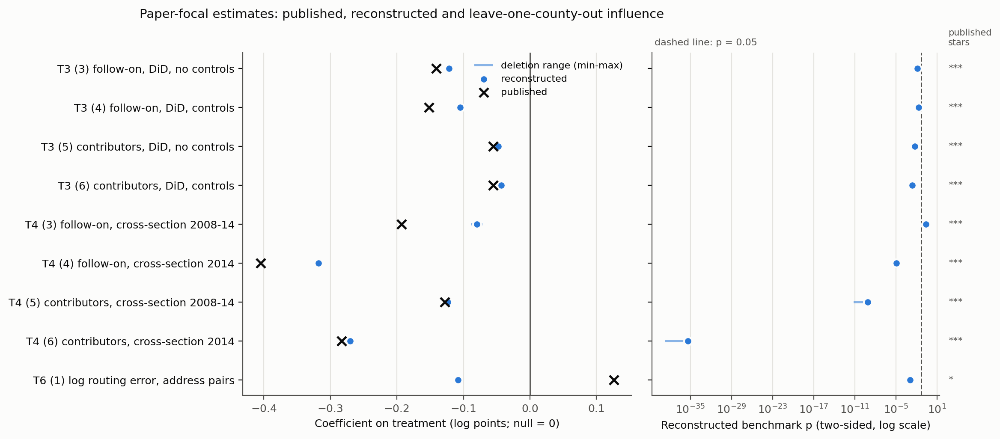

# Replication report: Nagaraj (2021), "Information Seeding and Knowledge Production in Online Communities: Evidence from OpenStreetMap", Management Science 67(8)

Public distribution copy: omitted data, source documents, row-level outputs and private logs are documented in ../README.md. Original run hashes remain historical evidence; export hashes are in ../export_manifest.json.

Study nagaraj2021, shared-data replication project v1. Coordinator session 7b25094b-ed7e-4d4a-89a8-a750dd9f7126, research run on 2026-11-01. No human reviewed this report or any classification in it.

## Findings

The paper-level outcome under the frozen protocol is indeterminate. Of the nine paper-focal claims (the difference-in-differences and cross-sectional effects on follow-on contributions and contributors, and the quality effect), one is consistent (Table 3 column 5), one is fragile-inference (Table 3 column 3), six are indeterminate, and one, the Table 6 quality effect, is discrepant. The discrepancy survived adversarial review, but the review could not come from a model family independent of the implementations, so it is reported as not fully verified.

The direction of the activity findings reproduces. All eight paper-focal activity estimates are negative, as published, and seven of them are significant at 0.05 under the benchmark inference; Table 4 column 3 is not (p = 0.23). Among the robustness columns, the boundary-sample follow-on cross-section (Table 5 Panel B column 1) and the timing-sample contributors panel (Panel A column 8) are not significant either. Magnitudes are generally smaller than published (for example Table 3 column 4: published -0.152, reconstructed -0.105). The quality finding does not reproduce from the written methods: the article defines the error score as an absolute difference, and with that definition treated counties have a lower routing error (-0.108, p = 0.001), against the published higher error (0.126, p < 0.10).

After unsealing, the author code explains almost all of the gaps. The code keeps Massachusetts as control counties although the article says Massachusetts is excluded. It interpolates and extrapolates the controls, which the article does not describe. It uses a signed log error for Table 6, where the article says absolute value. It defines the timing sample as twelve months either side of June 2005, where the article says calendar 2005-2006. Changing the frozen AI code to make these author choices brings every Table 3, 4, 5B and 7 claim within 0.36 published standard errors. The signed error alone reproduces Table 6 (0.125 against 0.126). The side-by-side figure comparisons show the same pattern. The urban reversal in Figure 6(a) appears only under the author's pooled regression without controls, not under the per-decile estimation the article describes. The published timing map matches the code's timing window rather than the calendar years in the text. The published record is also internally inconsistent in places that both readers flagged before any data were touched: the county totals, the boundary and timing sample labels, the Table 5 Panel A column headings, and the ownership labels in Tables 2 and 7.

These results reconstruct from the depositor's processed aggregates, not from OpenStreetMap or Census sources. The author rerun (comparison 2) could not be run because Stata is not installed.

## Scope, inputs and what was reconstructed

Scope was the main-text Tables 1-7 and Figures 1-6, fixed at setup. The empirical inputs were the 14 deposited data files (OSF node a47e9, CC-BY 4.0; all 60 deposit files matched the OSF SHA-256 values) and the Census TIGER/Line 2010 county file. The data were author-processed before deposit. quarterly.csv, h12.csv and tiger_census_2008q2.csv were computed by the author from OpenStreetMap history files, and other files were pre-processed. This study therefore tests reconstruction from the deposited aggregates, not from raw sources. Some inputs cannot be rebuilt by anyone else: timing.xlsx (Census Bureau, personal communication), amenitycheck.csv (proprietary InfoUSA data) and distance.csv (2017 Google Maps and OSRM queries).

Six deposited files fed the in-scope analyses: quarterly.csv, county_lookup.csv, acs5year.dta, timing.xlsx, boundary-counties.csv and distance.csv. The implementer bundle was built by code with no rows filtered. OpenStreetMap user names in h12.csv and free-text event descriptions in osm-events.csv were replaced by stable codes, and no name was printed or sent to a model. Implementers developed only against synthetic data in the real formats. The coordinator ran their frozen scripts on the real files with network access denied by sandbox-exec, a restriction tested before execution.

Reconstructed: Tables 1-7 and Figures 1(a), 2, 4, 5 and 6 as county-level quantities. Not audited: Figure 1(b), an illustrative image pair, and Figure 3, for which neither reader recorded numeric targets. The ACS controls in the deposit cover 2005-2011, while the article describes 2009-2014 estimates and 2014-2005 changes. Three of the article's nine listed controls (median age, IT workers, highly educated) are not in the deposit. The ten controls of the appendix tables were used.

## Comparison 1: AI reconstruction against published results

Paper-focal claims (effect scale: coefficient on the treatment term, natural-log outcome, null value 0). Benchmark inference is county-clustered CR1 for panel and address-pair models and HC1 for county cross-sections. z is the distance from the published rounding interval in published-SE units.

| Claim | Published (SE) | Published N | Reconstructed (benchmark SE) | Benchmark p | N | z | Outcome |
| --- | --- | --- | --- | --- | --- | --- | --- |
| T3 (3) follow-on, DiD | -0.141*** (0.0484) | 121,173 | -0.122 (0.049) | 0.012 | 120,705 | 0.39 | fragile inference (one band weaker clustered; HC1 p < 1e-13) |
| T3 (4) follow-on, DiD, controls | -0.152*** (0.0448) | 121,173 | -0.105 (0.045) | 0.020 | 110,391 | 1.04 | indeterminate: magnitude grey zone |
| T3 (5) contributors, DiD | -0.0557*** (0.0171) | 121,173 | -0.048 (0.017) | 0.005 | 120,705 | 0.46 | consistent |
| T3 (6) contributors, DiD, controls | -0.0556*** (0.0143) | 121,173 | -0.043 (0.014) | 0.002 | 110,391 | 0.86 | indeterminate: magnitude grey zone |
| T4 (3) follow-on, 2008-14 | -0.193*** (0.0604) | 3,107 | -0.080 (0.067) | 0.233 | 2,451 | 1.87 | indeterminate: label-sensitive |
| T4 (4) follow-on, 2014 | -0.405*** (0.0657) | 3,107 | -0.318 (0.072) | <0.001 | 2,451 | 1.32 | indeterminate: magnitude grey zone |
| T4 (5) contributors, 2008-14 | -0.128*** (0.0166) | 3,107 | -0.124 (0.020) | <0.001 | 2,451 | 0.23 | indeterminate: sample reconstruction, inconsistent targets |
| T4 (6) contributors, 2014 | -0.283*** (0.0186) | 3,107 | -0.271 (0.021) | <0.001 | 2,451 | 0.64 | indeterminate: magnitude grey zone |
| T6 (1) log error, address pairs | 0.126* (0.0708) | 81,007 | -0.108 (0.033) | 0.001 | 80,370 | 3.30 | discrepant, not fully verified |

N differs throughout. The universe has 3,095 counties because the article excludes Massachusetts, against the published 3,107. Models with controls lose counties because the deposit's 2011 ACS row lacks median earnings for 671 counties, and the frozen fallback rule (written by the coordinator, not stated in the article) carried whole years but not single values.

Claim-level outcomes across all 84 ledger units: 17 consistent, 1 fragile inference, 53 indeterminate, 8 discrepant (not fully verified), 5 not audited. The consistent claims are Table 3 columns 1 and 5, the two placebo columns of Table 5 Panel A, 11 of the 18 Table 2 rows, and both Figure 4 series. The indeterminate reason codes are: magnitude grey zone 16, measurement 10 (Table 1 outcome rows and some Table 2 rows), sample reconstruction with inconsistent targets 9, inconsistent targets after adversarial review 6, source vintage after adversarial review 6 (the Table 1 control-change rows), plot reading 4 (Figures 5 and 6) and label-sensitive 2. The discrepancies are the six Table 6 Treat and Distance terms, Table 5 Panel A column 8 (timing-sample contributors) and the Figure 2(b) timing-sample count. No claim had genuinely equivalent alternatives, so specification fragility was not assessed for any claim. The uncertain branches are reported separately in the technical supplement.

The placebo check reproduces in kind. The reconstructed placebo estimates are not significant (p = 0.12 and 0.68), and 6.0% and 5.5% of 200 placebo draws had p < 0.05.

## Comparison 2: author code rerun

Not run. Stata is not installed on this machine, and the study instructions forbid translating the code as a substitute. The code was read first: it touches only files under a user-set path and makes no network calls. Figures 1 and 2 are not produced by code. This is a finding about missing software, not about the results.

## Comparison 3: AI code against author code

The full comparison is in post_unseal/comparisons_2_and_3.md. Each difference was classified by written source and tested by changing the frozen implementation-A code one difference at a time (post-unsealing diagnostics; reports/data/post_unseal_variant_diagnostics.csv).

- Stated in the article, code departs: Massachusetts included as controls. This moves Table 3 columns without controls from 0.39-0.46 to 0.08-0.09 SE, and Table 6 N to exactly 81,007. The Table 6 outcome is the signed log error; this alone changes Treat from -0.108 to 0.125 and Distance from 0.052 to 0.035, against published 0.126 and 0.034. The timing sample is twelve months around June 2005 (1,809 counties; with Massachusetts 1,822, against the 1,820 the text calls the boundary sample). Figure 5 omits controls and quartile effects, because the locals that define them are out of scope where the regressions run.
- Stated nowhere: per-county interpolation and extrapolation of controls. This is the largest driver, moving Table 3 columns with controls from 0.86-1.23 to 0.27-0.33 SE and Table 4 from up to 1.87 to at most 0.42. Other unstated choices: cross-section controls at 2014 values, quartile cut-points over panel rows, Table 5 Panel A without controls, the Figure 6(a) pooled interaction model without controls, Figure 6(b) without controls, a Student t-test in Table 1, the Hawaii drop and one FIPS recode.
- Publication inconsistencies confirmed by the code: the boundary and timing sample labels are swapped in the text and Figure 2; the Table 5 Panel A headings do not follow the order in which the estimates are stored; Tables 2 and 7 label the ownership columns differently; and Table 2 includes Massachusetts although its note excludes it.
- AI misreading: none identified. The interpolation gap traces to the coordinator's fallback rule.

With all of the author choices applied together, every Table 3, 4, 5B and 7 claim lies within 0.36 published SE and Table 6 Treat within 1.18 SE. These diagnostics do not revise any frozen score.

## One claim from text to score: Table 6, column 1

The article says the error score is "the absolute value of the difference in length" between OSRM and Google routes, logged (D01 p.11; Table 6 note, p.18). Both readers coded the origin as ln|OSRM - Google| at the address-pair level, labelled equivalent. Opus also proposed ln(|d| + 1) and Astra a difference of logs, both uncertain. The frozen grid ran the origin (S00044) and 35 uncertain rows: two transforms, two control transformations, three control years and two quartile sets. The three implementations agreed exactly on -0.108 (CR1 SE 0.033, N 80,370), against published 0.126 (0.0708). The sign is opposite and the gap is 3.30 SE, and none of the 35 uncertain rows came within the frozen pass criteria, so the scorer marked a discrepancy candidate. The adversarial reviewer matched the published N exactly by adding Massachusetts and tried every reading with a textual basis; Treat stayed negative, and the discrepancy survived. After unsealing, make_directions.ado showed the sign flip applied to the log error when the OSRM route is shorter. Adding that flip to the frozen code gives 0.125. The difference lies between the article's stated measure and the code that produced the table.

## Models, refits and labels

- Grid: 1,295 rows per implementation. That is 112 origin specifications, 530 single-axis deviations, 253 crossings of uncertain axes for the nine paper-focal models, and a 400-draw placebo distribution. The three implementations are repeat runs of the same grid, not new specifications: 3,885 row executions and 1,389 regression terms per implementation.
- Labels: equivalent alternatives 0. Uncertain alternatives 783 rows (deviations and crossings). Non-equivalent alternatives recorded but not run: a smaller unstated universe; unfilled panel rows; Post from 2007q4; group linear trends; county-mean error outcome; density-only quartile effects. Unavailable and not run: period-distinct contributors and 2009-2014 ACS (not in the deposit); geometric adjacency (no R geometry library); an SB Selected date (the column is a code); disjoint percentile groups.
- Algebraic checks, not counted as fits: Table 6 Distance under miles (the coefficient rescaled).
- Influence: 22,409 leave-one-county-out refits for the nine paper-focal models, by implementation A for all deletions and repeated in full by implementation C. Zero failures, and A and C agreed on every refit. The plan required C only for a 50-county subset.
- Post-unsealing diagnostics: 7 variants x 72 origin rows.

## Readers, reconciliation and implementations

Two readers read the identical 20-file packet: Claude Opus 5.5 (fast mode, reported "fast") and GPT-6 Astra (Ultrafast requested; the Codex CLI does not report the tier, so it is unverified), both High effort. Each was preceded by a sealed title-only memorization probe. Both models said they partly recalled the paper and its direction of effect, and neither recalled any number or deposit detail (checks/memorization_probes.md).

Initial reader agreement, before any clarification round (none was used):

- Tiers over 84 ledger units: observed 0.905, Gwet's AC1 0.883. Focal versus other: AC1 0.962.
- Specification labels over 15 matched level pairs: observed 0.533, AC1 0.310.
- Transcription: 164 of 164 regression fields (coefficient, SE, stars, N) identical.

Disagreements were kept as uncertain, and the union of structures was retained (reconciliation/axis_ledger_v1.json). Coordinator decisions are disclosed as such. Fallback rules for three choices both readers marked unstated: control transformation, cross-section control year and panel-year matching. Paper-focal claims were designated from the abstract.

Implementations: A was Claude Opus 5.5 in R, B was GPT-6 Astra in R and C was GPT-6 Astra in Python, each in a fresh process with no access to the article, targets or each other. Cross-family pre-execution checkers found no defect affecting the frozen run (checks/pre_execution/disposition_v1.md). On the real data, A and B agreed on all 1,389 regression terms. C differed on the 12 rows with the R2 quartile reference set, where the manifest was ambiguous, and all descriptive outputs agreed.

The coordinator was Claude Opus 5.5, High effort, fast mode off as pinned in .claude/settings.json; effort and speed are not observable inside the desktop app. The coordinator and Reader A are the same model. Readers, probes, implementers and checkers ran as separate CLI processes from neutral staging folders. All of them ran inside a sandbox-exec profile that denied the project, the Dropbox folder and the user's global Codex AGENTS.md, so the file barrier was enforced. Their commands' network access was not, and the no-browsing rule rested on instructions.

## Reconstruction and influence checks

Caption. Nine paper-focal claims, rows in the fixed order of the frozen rules. Left: published coefficient (cross), reconstructed origin coefficient (dot) and the minimum-to-maximum range across all leave-one-county-out refits (line). Coefficients are in log points, with a zero reference line; Table 6 is the log routing error, the other rows are log activity counts. Right: reconstructed two-sided benchmark p (county-clustered for panel and address-pair models, HC1 for county cross-sections) and the range of deletion p-values, log scale, with 0.05 dashed; published stars at right. Samples: 3,095 counties (120,705 county-quarters) without controls, 110,391 county-quarters with complete panel controls, 2,451 counties in the cross-sections and 80,370 address pairs. Missing controls drop observations listwise. Data are the deposited author aggregates; measurements were reconstructed independently from the written methods by three implementations. Deletion ranges are influence ranges, not confidence intervals, and they are not part of any equivalent-specification set. Data and provenance: reports/figures/figure_focal_influence.csv; script: reports/figures/make_figure.py.

What it supports: no single county drives any focal estimate. Deletion ranges are narrow (at most 0.017 log points), and no deletion changes a sign or crosses the 0.05 threshold. Table 4 column 3 stays non-significant under every deletion (p 0.18 to 0.28), and every other row stays below 0.05 under every deletion. What it cannot establish: whether the gaps to the published values come from definitions, which is the question of comparison 3, or any fragility verdict.

## Figure comparisons

Public-copy note: the side-by-side images containing published article panels are not redistributed. The diagnostic descriptions below are retained; references to panel positions refer to the full archived report. The original reconstruction-and-influence figure above is included.

Each comparison sets the published figure (left, cropped from the frozen article PDF, page given in the panel title) beside the reconstruction drawn from frozen implementation-A outputs. Where the author code builds the figure differently from the written methods, a further panel shows the author specification. Reconstructed and author panels are drawn in the published figure's own visual form: the same chart type, markers, line styles, uncertainty display (for example dashed bound lines in Figure 4), reference lines and axis ranges, widened only where the reconstruction falls outside them. The readers' plot readings are overlaid as orange open triangles with thin interval bars, an encoding the published figures do not use. That specification is computed on the AI-constructed data as a post-unsealing diagnostic, by a script that first reproduced A's frozen Figure 3 means (to 5e-15) and Figure 4 coefficients (to 2e-13). None of this changes a frozen score. The section was added after first delivery at the user's request, and the project now requires it (instructions/reporting.md). The current images are version 2, restyled to the published forms; version 1 is kept in reports/figures/comparison_v1/. Source files: reports/figures/comparison/ (PNG, SVG, published crops, provenance.json; scripts code/make_figure_comparisons.py and code/figure_diagnostics.py).

### Figure 1(a): treated and control counties

The treated-county geography matches, because both maps use the deposited treatment coding. The reconstruction has 3,095 counties (1,852 treated, 1,243 control) with Massachusetts left blank, as the article states. The author specification keeps Massachusetts as 14 controls (3,109 counties). Only the printed counts are scored.

### Figure 2(a): boundary sample

The published boundary map looks like the reconstructed boundary sample of 2,214 counties (1,228 treated, 986 control). The Figure 2 note and the text give the boundary sample as 1,820 counties. That count belongs to the timing sample (next panel), so it is the printed count that is wrong, not the map.

### Figure 2(b): timing sample

The published timing map does not look like the calendar-2005-2006 sample the text describes (centre, 1,568 counties). It does look like the code's window of twelve months around June 2005 (right, 1,809 counties), including the contiguous treated blocks in the central plains and the mid-South. The maps therefore carry the code's samples under the right titles, and the counts in the note and text are swapped. This reading is visual and qualitative.

### Figure 3: mean outcomes over time

Not scored, because no reader recorded targets for this figure. The published panels plot one point per year. The reconstruction  is quarterly, as the frozen manifest specifies, with large swings around the 2007q4 import. The author's annual aggregation, computed on the AI panel , follows the published levels, for example logged contributions in 2014 at about 6.5 for controls and 5.7 for treated. The control-treated gap in cumulative counts appears in both.

### Figure 4: event study

The reconstruction uses the same specification as the author code. The shape matches. The pre-period follow-on coefficients are smaller (0.088 against about 0.12 in 2005), consistent with the Massachusetts difference. 80% of the read points fall within the reading intervals, so the claim is scored consistent.

### Figure 5: year-by-year cross-sections

The reconstruction  follows the written specification, with controls and quartile effects, and is attenuated in 2007-2010. The author specification  drops both, because the locals that define them are out of scope where the code runs the regressions, and it uses the yearly mean outcome. It comes closer but still sits above the published points in 2007-2009. The remaining gap was not traced further.

### Figure 6(a): effects by population-density decile

Neither AI estimator matches the published figure: separate DiD fits per decile with controls (top row) or cross-sections per decile (middle row). Both follow the article's description of estimating effects "separately for counties based on the decile". The author's single pooled regression without controls (bottom row) reproduces the published points closely. For follow-on contributions it gives deciles 1, 9 and 10 at -0.345, 0.073 and 1.075, against readings of -0.380, 0.047 and 1.077. For contributors it gives deciles 1 and 10 at -0.276 and 0.519, against -0.286 and 0.521. The urban reversal the article reports therefore depends on that pooled specification. Under either AI estimator, the top-decile effect on follow-on contributions is near zero or negative.

### Figure 6(b): effects by contributor type

The author specification without controls gives -0.052, -0.022, -0.020, -0.036, -0.025 and -0.004 for the 10th to 99th percentiles. That is closer to the published readings (-0.059, -0.028, -0.026, -0.040, -0.027, -0.003) than the AI reconstruction with controls. Both show the pattern the text describes, with effects shrinking toward zero at the 99th percentile.

What the comparisons cannot establish: visual similarity of maps is not a county-by-county check, plot readings carry reading error, and the author-specification panels show what the code computes on the AI panel, not a rerun of the author's Stata pipeline.

## Supplements and the publication packet

- D01, the article (publisher version, 28 pages): read in full.
- D02, the online appendix, deposit copy (14 pages; identity with the journal's supplement not checked): used for the ten-control list (Tables D.3-D.4) and the quartile variables. Appendix D.4's note names population where the main text names density, and the main text was used.
- D03: the deposit Readme's data section.
- D41-D54: column names and types.
- D60: TIGER field names.

The main text conflicts with itself or with the appendix on the control list (nine variables against ten), the ACS years, the county totals (3,107 and 3,093), the panel N (121,173 and 120,627) and the sample labels. All are recorded in the readers' forensic files and in reconciliation. No document was added after reading began.

## Limitations

- The deposited data are author aggregates, which removes the sample-reconstruction problem that drives many gaps in public-source replications.
- A match does not prove the models did not recall the paper. The probes showed qualitative recall only.
- One paper does not generalize to its design class.
- The coordinator wrote the fallback rule for control years, which lost counties with a missing value. The study reports its effect rather than changing it.
- The Table 5 Panel A labels and the boundary/timing labels are inconsistent in the publication. Several claims are indeterminate for that reason, not because of the reconstruction.
- The adversarial review used the same model family as implementation A and Reader A, so no discrepancy is fully verified.
- No human reviewed any step.
- Fast mode and Ultrafast change speed and price, not the model; Ultrafast could not be confirmed from the CLI output. The scoring constants are provisional and uncalibrated.
- The scorer was revised once before unsealing to implement two frozen rules it had omitted: the inconsistent-targets sub-code and the Table 5 label-swap diagnostic. The omission was found after the first scoring run. Version 1 and its output are kept (code/score_v1.py, runs/run_20261101_v1/scoring_v1/), and no outcome category changed.

Details: reports/technical_supplement.md. Data: reports/data/.
