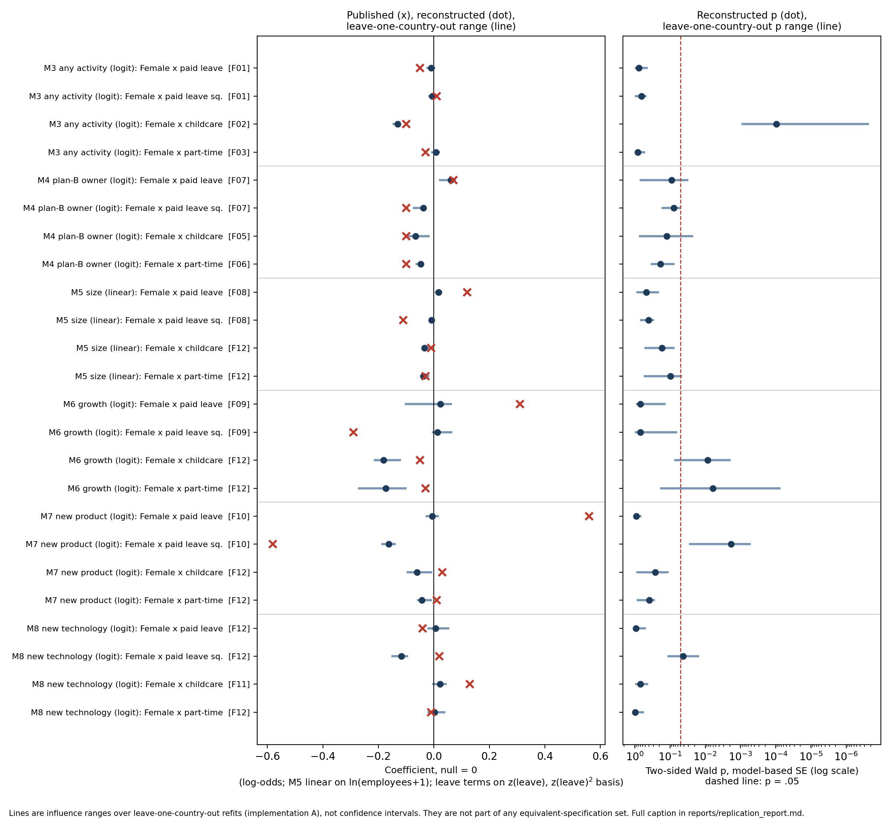

# Replication report: Thébaud (2015), "Business as Plan B"

Study thebaud2015. Article: Sarah Thébaud, "Business as Plan B: Institutional Foundations of Gender Inequality in Entrepreneurship across 24 Industrialized Countries", Administrative Science Quarterly 60(4): 671–711, DOI 10.1177/0001839215591627. Execution exec_v1, frozen scoring rules v1 with addenda v1.1 and v1.2. Report date 2026-10-28.

Status: final for this session. Every score below rests on implementation A, which agrees with implementation B on all 276 original-specification terms. At the user's direction, the third implementation (C, Julia) was stopped before it produced any output, so the deviation grid and influence refits come from A alone. No reviewer from a model family independent of every implementer was available, so no fully verified discrepancy is claimed.

## Findings and scope

Paper-level outcome under the frozen aggregation rule: indeterminate.

| Hypothesis | Focal claims | Outcome |
| --- | --- | --- |
| H1: state childcare widens the gender gap in entrepreneurial activity | F02 (M3, female x childcare) | consistent |
| H2: work-family policy and women's plan-B ownership | F05, F06 (M4, female x childcare, female x part-time) | discrepant_candidate |
| H3: paid leave and women's high-quality ventures (size, growth, new product, new technology) | F08–F11 (M5–M8) | indeterminate: incomplete coverage |

The rule makes the paper indeterminate whenever any focal hypothesis is indeterminate. H3 is indeterminate because the reconstructed owner samples for M5 and M7 differ from the published N by more than 15%. The rule forbids scoring a discrepancy on a sample that was not reconstructed. H2 holds discrepant candidates only. Both adversarial reviews leave F05 and F06 short of a supported discrepancy (details below), and the family-independent review needed for full verification was unavailable.

What reproduces. The central entry result reproduces. In M3 (any entrepreneurial activity, 342,734 respondents, 139 surveys, 23 countries), female x state childcare spending is −0.131 (SE 0.034, p = .0001) against a published −.10 (.04), three stars. The female main effect in M1–M3 also reproduces (−0.56 to −0.57 against −.57 and −.58). The nonsignificant M3 interactions for leave and part-time reproduce as nonsignificant, though two land in the grey zone because the sign is not determinate. Robustness model A3 M3 also reproduces.

What does not reproduce under the frozen specification:
- In M4 (plan-B motivation among owners), female x childcare is −0.066 (.043, p = .12) against −.10 (.04), two stars. Female x part-time is −0.047 (.036, p = .19) against −.10 (.03), three stars.
- The curvilinear paid-leave pattern for growth aspirations (M6) is not recovered: 0.023 and 0.013 against .31 and −.29.
- For new products (M7), we recover the leave-squared term, which is significant (−0.162, p = .002), but not the linear leave term.
- The M6 female main effect is −0.82 against −.29.

Specification fragility was not assessed. No alternative was labelled equivalent by both readers, so the equivalent set is empty. Uncertain alternatives and influence refits are reported separately and do not establish robustness or fragility.

## Data: what was reconstructed and where it came from

Individual-level data were user-supplied. The user downloaded GEM Adult Population Survey Data Set 1998–2017 (ICPSR 20320, version 6, 2022-07-12, Paul D. Reynolds) from ICPSR by hand and saved it in data/supplied/ICPSR_20320/. No agent downloaded or logged in to ICPSR. The source-validation role confirmed:
- The checksums of all seven files.
- Identity and version.
- The terms of use.
- Readability in Python and R: 2,796,985 records, 97 variables.
- That all 143 survey-years in the paper's Table A1 are present.

Limits found in this release (registry/validation/README.md):
- NBSTATUS (social status of entrepreneurship) has no responses for 2001–2002 in any country. Agents checked the original GEM 2001–2002 public files and found the same gap. The manifest carries back each country's earliest later value.
- France 2003 lacks work status and education, so it contributes no cases.
- The harmonized v6 file may differ from the author's unnamed GEM release: exact ages are imputed from categories, owner status is reclassified, motives are recoded, and business start year is top-coded at 1990.
- The paper does not mention weights. The weighted alternative U21 could not be run: lme4 accepts only individual-level weights, and MixedModels.jl does not accept weights in generalized mixed models.

Country-level inputs were newly acquired by agents in this session from public providers (registry/source_registry.json):
- Paid leave: CEPR parental-leave report 2008, ILO TRAVAIL maternity pages and OECD Family Database PF2.5.
- Childcare: OECD PF3.1 and SOCX.
- Part-time employment: OECD Labour Force Statistics.
- EPL: OECD EPL.
- Unemployment: OECD.
- GDP per capita PPP: World Bank WDI.
- Women managers: UNDP Human Development Reports.
- Fertility: World Bank WDI.

Construction scripts and lineage are in registry/construction/ and data/derived/country_year_lineage.csv.

Documented measurement differences:
- Childcare is total early-childhood education and care spending, including pre-primary. The current OECD series has no annual childcare-only component.
- The year-specific paid-leave series (FTE weeks, lagged one year) is our own reconstruction, made by scaling the CEPR 2008 level with PF2.5 paid-week ratios. It leaves the Czech Republic missing in every year and France missing for 1998–2003. Models with leave therefore drop CZE and early French surveys.
- EPL is the current regular-contracts index.
- The GDP index applies the UNDP formula to current WDI data.

No observation, correlation matrix or table printed in the article or supplement was used as an empirical input. The adversarial reviewers used printed descriptives (Tables A1 and A2) after the fact, as publication diagnostics only.

## Published versus reconstructed focal estimates

All estimates come from implementation A. Implementation B agrees within tolerance (estimates within 0.05 SE, SEs within 5%, identical samples). The coefficient scale is log-odds except M5, which is linear on ln(employees + 1). The null is 0. "Distance" is the gap from the published rounding interval in published-SE units. Inference uses two-sided Wald p values on model-based SEs. The benchmark is pooled logit (OLS for M5) with country-clustered CR1 SEs, plus a wild cluster bootstrap for the M5 interactions.

| Claim | Model, term | Published | Reconstructed (SE), p | Distance (pub. SE) | N published / reconstructed | Outcome |
| --- | --- | --- | --- | --- | --- | --- |
| F04 | M1 female | −.57 (.04) *** | −0.562 (0.042), <.001 | 0.06 | 354,143 / 345,570 | consistent |
| F02 | M3 female x childcare | −.10 (.04) *** | −0.131 (0.034), <.001 | 0.64 | 354,143 / 342,734 | consistent |
| F01 | M3 female x leave; x leave² | −.05; .01 | −0.010 (0.032); −0.005 (0.011) | 0.44; 0.13 | same | grey zone |
| F03 | M3 female x part-time | −.03 | 0.007 (0.032), .83 | 0.80 | same | grey zone |
| F05 | M4 female x childcare | −.10 (.04) ** | −0.066 (0.043), .12 | 0.71 | 28,775 / 31,520 | discrepant_candidate |
| F06 | M4 female x part-time | −.10 (.03) *** | −0.047 (0.036), .19 | 1.59 | same | discrepant_candidate |
| F07 | M4 female x leave; x leave² | .07 (.10); −.10 (.11) | 0.061 (0.036); −0.037 (0.021) | 0.04; 0.52 | same | grey zone |
| F08 | M5 female x leave; x leave² | .12 (.06) **; −.11 (.06) * | 0.017 (0.024); −0.009 (0.011) | 1.63; 1.61 | 28,775 / 33,626 | incomplete coverage |
| F09 | M6 female x leave; x leave² | .31 (.14) **; −.29 (.14) ** | 0.023 (0.061); 0.013 (0.033) | 2.01; 2.13 | 28,775 / 29,961 | discrepant_candidate |
| F10 | M7 female x leave; x leave² | .56 (.23) **; −.58 (.24) ** | −0.006 (0.059); −0.162 (0.052) | 2.44; 1.72 | 27,107 / 32,890 | incomplete coverage |
| F11 | M8 female x childcare | .13 (.07) * | 0.022 (0.056), .69 | 1.47 | 17,498 / 19,944 | grey zone |
| F12 | M5–M8 nonsignificant interactions | various | see term_comparisons.csv | | | incomplete coverage |
| R01 | A3 M1 (nascent) female x childcare | −.09 (.04) ** | −0.058 (0.048), .23 | 0.69 | 354,143 / 342,734 | discrepant_candidate |
| R02 | A3 M2 (incl. not employed) female x childcare | −.10 (.03) *** | −0.116 (0.034), <.001 | 0.36 | 417,026 / 438,919 | grey zone |
| R03 | A3 M3 (2003–2008) female x childcare | −.08 (.03) *** | −0.064 (0.031), .04 | 0.36 | 265,075 / 256,913 | consistent |

Under scoring addendum v1.1, a claim's outcome is its worst term outcome, and an N mismatch takes precedence over the discrepancy criteria. Three nonfocal control terms (postsecondary in M1–M3) score as fragile inference: their benchmark p rises above .5. Five year dummies are absent from the M7 and M8 samples and are recorded as not estimated. Every term is in reports/exports/term_comparisons.csv.

## One worked example: H1, female x childcare in M3

1. Article text: MAIN pp. 8–9 argues that publicly funded childcare widens the gender gap in entrepreneurial entry. Table 1 Model 3 prints female x state childcare spending as −.10 (.04) with three bullets.
2. Readers: Reader A (Claude Fable 5.1) and Reader B (GPT-6 Astra) worked independently from the identical frozen packet. Both labelled this claim focal and transcribed −.10, SE .04, three bullets.
3. Reconciliation: Both readers chose 19–54 employed respondents. They split on the age bounds and the activity coding; the coordinator resolved each split by literal wording ("over 18 and under 55", SUBOANWT or OWNMGE) and kept the other reading as uncertain branches (U01, U03, U04). The childcare measure is the 2005 and 2007 OECD values, interpolated for 2006 and carried to earlier and later years. Survey-level variables are z-standardized over the 139 surveys of the M3 sample.
4. Frozen specification: These choices went into manifest_neutral.md, which carries no article identity or targets.
5. Implementation and execution: Implementations A and B wrote code from that manifest alone. Both were checked before execution and run on the frozen data under a network sandbox. Their estimates were −0.13076 and −0.13076, with identical samples.
6. Scoring: The estimate is 0.64 published SE from the rounding interval (within). The inference band matches (p < .01). The sign matches. N differs by 3.2% (match). The benchmark p is also below .01. Result: consistent.
7. Stress tests: Across 13 substantive uncertain fits, every estimate lies between −0.137 and −0.119, all with p < .001. Across 23 leave-one-country-out refits, the range is −0.149 to −0.120, all with p ≤ .001.

## Model settings and influence refits

| Set | Fits | Notes |
| --- | --- | --- |
| Origin | 11 models x implementations A and B | M1–M8 and A3 M1–M3. Implementation C stopped by the user before producing output. |
| Equivalent | 0 | No level labelled equivalent by both readers |
| Uncertain, substantive | 84 (A) | 21 branches (U01–U20, U22–U26) over their registered models |
| Uncertain, algebraic re-expression | 18 (A) | U14 (separately standardized leave²), U15, U16 (other standardization constants). Identical log-likelihood; checks, not alternatives. |
| Uncertain, realized duplicate | 5 (A) | U08 (owner check) produced the origin sample exactly |
| Non-equivalent | 6 (A) | N01, drop 2001–2002 surveys. For M8 it is a re-expression only. |
| Unavailable | U21 | Survey weights not supported for these models |
| Influence | 137 (A) | Leave-one-country-out for M3–M8 (23 countries; 22 for M8). None failed; 6 did not converge; 34 singular (22 of them in M5). |

All 113 deviation fits returned estimates. Six did not converge: U02 M7, U20 M6 and M7, U22 M6, U24 M6, N01 M6. They are retained and flagged. Full results are in reports/exports/specification_results.csv and influence_results.csv. Uncertain-set summaries for the focal terms, excluding re-expressions and duplicates, are in reports/exports/uncertain_set_substantive.csv.

Uncertain-set observations, which are not a fragility verdict:
- For M3 childcare, every substantive branch is significant in the published direction.
- For M4 part-time, one branch out of 15 reaches p < .05: U18, the two-year leave lag, at −0.073 (p = .046).
- For M4 childcare, none does; the closest is U09 (plan-B coding OMREASON 2 or 3) at p = .07.
- For M5 and M6 leave, no branch comes near the published values.
- For M7 leave², 12 of 13 branches are significant in the published direction.

## Figure: public-source reconstruction and influence checks

Files: reports/figure/influence_figure.svg, influence_figure.png and influence_figure.csv (plotted values, identifiers, provenance). Script: reports/figure/make_figure.py.

Caption:
- Rows: all 24 female x institution interaction terms of M3–M8, in a fixed order chosen before results.
- Claim IDs: shown in brackets. F12 marks interactions the article reports as nonsignificant.
- Left panel: the published coefficient (cross), the reconstructed coefficient from implementation A (dot), and the minimum-to-maximum coefficient over all leave-one-country-out refits (line). Coefficients are log-odds, except M5, which is linear on ln(employees + 1). The null is 0.
- Leave terms: on the frozen basis, z(leave) and z(leave)². The article may have used a separately standardized squared term, so leave coefficients are not directly comparable with the printed ones (see below).
- Right panel: the reconstructed two-sided Wald p (dot) and the range of p over the refits (line), on a log scale, with the paper's .05 threshold dashed. No p value underflowed.
- Refit settings: standardization constants and centering means stay at full-sample values, so each refit changes only the data.
- Sample sizes: M3 342,734; M4 31,520; M5 33,626; M6 29,961; M7 32,890; M8 19,944. Missing values are handled by complete cases per model.
- Sources: the user-supplied ICPSR 20320 v6 file and country inputs newly acquired from OECD, CEPR, ILO, World Bank and UNDP, all independently constructed.
- What the lines are: influence ranges, not confidence intervals, and not part of any equivalent-specification set.

What it supports and what it cannot. The figure shows several things:
- The M3 childcare result is far from zero and stays significant under every country deletion.
- The M4 childcare range reaches the published value. Deleting one country moves the estimate to −0.105 and p to .02.
- The M4 part-time range does not reach the published value.
- The M6 and M7 linear-leave targets lie far outside every refit.

It cannot establish fragility or robustness, and it does not show how the published estimates were produced.

## Reader agreement, reconciliation and implementation

Readers. The two readers worked independently from an identical packet (main article and supplement S1), with summary-free source dictionaries, and saw no data. They agreed on:
- Claim tier: 29 of 31 matched claim units (93.5%, Gwet AC1 .92).
- Specification labels: 17 of 32 matched levels (53%, AC1 .34).
- Origin choice: 20 of 32 levels (62.5%, AC1 .29).
- Target transcription: 357 of 358 values.

No clarification round was held. The coordinator applied the frozen rules: different labels become uncertain; the union of structures is kept; a one-reader equivalent label becomes uncertain; origins are resolved by literal text and then by the cited software's default. Every decision and disagreement is logged in reconciliation/coordinator_decisions.md and in the ledgers.

Executed configuration:
- Three-level random-intercept models with a random female slope at the survey and country levels, independent covariance.
- Laplace approximation, because adaptive quadrature is not feasible for this structure. This departs from the Stata melogit estimation the article cites.
- ML for the linear M5.
- Cross-level interactions of female with standardized survey-level policy measures; age and business age centered.

The exact manifest is reconciliation/frozen/manifest_neutral.md.

Implementations:
- A: Claude Fable 5.1, R lme4 2.1.0.
- B: GPT-6 Astra, R lme4.
- C: Claude Fable 5.1, Julia MixedModels 5.9.1.

Each was written in an opaque staging directory from the neutral manifest, without the article's identity or targets, and checked on synthetic data and by a separate pre-execution checker. A and B agree on all 276 original-specification terms with identical samples. C's original-specification run was stopped at the user's direction; the user terminated it at 01:36 UTC on 2026-10-28, after 8.4 hours, while it was fitting A3 Model 1. A took 2.1 hours. C writes estimates only at the end, so none were saved. Its log shows that M1–M8 converged on samples with the same N, country and survey counts as A and B. That is a partial check of sample construction only, not of the estimates. C's deviations and influence refits, and B's optional deviations, were not executed (runs/exec_v1/unexecuted_runs.json). The design therefore falls short of the workflow's three-implementation requirement: scoring uses the agreeing A–B pair, and the deviation and influence results have no second-implementation check.

Isolation and limitations:
- Network isolation was enforced with sandbox-exec. File-system isolation relied on instructions only.
- Stata was unavailable, so both R implementations use the same estimation library.
- A and C share a model family.

## Adversarial review of discrepancy candidates

Two reviewers examined the candidates after scoring, with access to everything:
- Claude Opus 5.5: audits/adversarial_v1/review.md, with a coordinator correction in coordinator_note.md.
- GPT-6 Astra: audits/adversarial_astra_v1/review.md.

Neither is independent of every implementer's model family. Their findings are post hoc and change no frozen score.

| Item | Claude review | Astra review |
| --- | --- | --- |
| F05 M4 childcare | (a) pipeline error: plan-B coding. Counting OMREASON 2 or 3 (branch U09) gives the article's stated 31% plan-B share; under U09, p = .07. | (d) U09 is plausible, but the article does not define the mixed category |
| F06 M4 part-time | (c) survives | (d) unresolved: U18 (two-year lag, discussed in footnote 8) lies within the criteria |
| F09 M6 leave | (d) unresolved: the growth outcome prevalence (10%) cannot match the published 17% | (d) unresolved |
| M6 female main effect | (d) unresolved | (d) unresolved |
| R01 | (b) the childcare series is a different concept | not reviewed |
| H3 N mismatch | (a) the article implies a common owner sample | (d) a common sample is suggested but not identified; it misses the 5% band |
| Leave x female SEs | (a) the published SE pattern matches separately standardized leave² (U14) | (d) basis change confirmed; the published basis is not identified |
| Leave series | (a) temporal mismatch with footnote 7 | (a) the same, a concrete construction mismatch |

Taken together, the adversarial reviews leave every discrepancy candidate short of a supported discrepancy. Both agree that the paid-leave series construction conflicts with the article's footnote 7, which names the eight countries whose policy changed. Correcting it moves no candidate by more than .03. Both agree the M6 results cannot be attributed either to the article or to an identified error of ours. A corrected analysis (v2) is possible, but it would be a new registration made after seeing the results, and it needs user authorization.

## Supplements and publication packet

The packet (sources/publication_packet.json) contains:
- MAIN: the issue version, 42 pages, SHA-256 65b93544….
- S1: the SAGE online appendix ds_10.1177_0001839215591627.pdf, 3 pages, Tables A1–A3, SHA-256 5f6590b9….

Neither was redacted, and neither contains code or links. The search for further supplements, errata and corrections covered Crossref, the SAGE page, author pages and repositories (sources/supplements/supplement_search.json); it found only S1 and no corrections.

Package eligibility: no author-provided data or code package exists (checks/package_eligibility.json). An OSF project (9sxua) is third-party and was not used.

Packet contradictions and gaps:
- Table 1 Model 2 prints a negative SE ("–.001") for age squared.
- A3 Model 2 has a blank fertility cell.
- The published M6 column shows an unstarred intercept at z ≈ 12 and zero survey-level SDs.
- The construction of the year-specific leave series and the source of the 2001–2002 status values are not published.

## Memorization probes

Both reader models received title-and-author probes. Their answers were sealed from the readers (sealed/memorization/). Both recognized the article and its argument. Neither recalled numeric results; Reader B explicitly reported no recall of countries, years or numbers.

## Remaining limitations

- Implementation C was stopped at user direction before saving estimates. Only its sample counts for M1–M8 could be checked, and they match. The deviation and influence results rest on A alone.
- No family-independent adversarial review was available, so no fully verified discrepancy is claimed.
- Calibration arms (planted errors, unreachable targets, null data, a post-cutoff stratum) were not run in this session, so no error rate is claimed.
- The source-vintage, childcare-concept, leave-series and status-carry-back differences above cannot be resolved from public sources.

Detailed records: reports/technical_supplement.md, reports/exports/, scoring/final_v1/, audits/, logs/coordinator_log.md.
