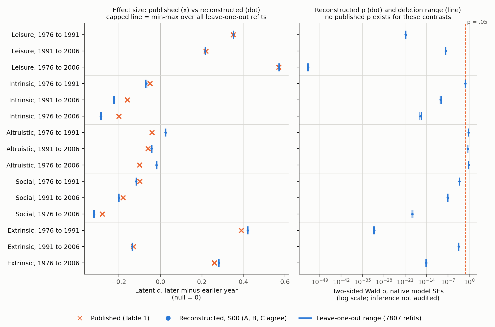

# Replication report: Twenge, Campbell, Hoffman and Lance (2010)

Generational Differences in Work Values: Leisure and Extrinsic Values Increasing, Social and Intrinsic Values Decreasing. Journal of Management, 36(5), 1117-1142. DOI 10.1177/0149206309352246. Study twenge2010, coordinator session 2cb83689-5c7d-4c08-adf1-ff316c5974d3, run run_20261028T035346Z. Details are in the [technical supplement](technical_supplement.md).

## Findings and scope

The paper-level classification under the frozen protocol is indeterminate (indeterminate focal evidence). Three of the five focal research-question claims are consistent with the reconstruction from public Monitoring the Future (MTF) data: leisure values rising, extrinsic values rising and then falling, and social values falling. The other two are indeterminate:

- Intrinsic: the reconstructed declines are larger than printed (d = -.22 and -.29 against -.16 and -.20). They fall 2-3 derived SE from the printed rounding intervals, the grey zone. The third contrast is printed as -.05 in Table 1 but .05 in the text.
- Altruistic: two of three contrasts are in the grey zone. The 1976-1991 contrast has the opposite sign (+.025 against -.04) but lies within 4 derived SE.

No focal claim is discrepant, so no focal result was tested for being "not reproduced". Directions agree for 14 of 15 contrasts. Three independent implementations agree on every scored quantity. Two R implementations (from two different model families) and one Python implementation all reproduce the same estimates to within 1e-5 in d.

Scope. The estimand is the standardized latent mean difference d between survey years (later minus earlier; null value 0), from a three-group partial-scalar-invariance confirmatory factor model of 19 Form 4 job-value items. These are descriptive cross-year differences among 12th graders surveyed in 1976, 1991 and 2006. In these data, birth cohort, survey period and age-at-survey cannot be separated. The reconstruction checks the printed differences; it does not test their interpretation as generational rather than period effects. Inference for the latent contrasts was not audited, because the scoring rules treat SEM inference as native-only. Specification fragility was not assessed, because after reconciliation no substantive alternative was agreed to be equivalent.

## Data: what was reconstructed and from where

All empirical inputs are original public-use MTF 12th-grade files that the user downloaded by hand from ICPSR and saved in data/supplied/. No agent downloaded or logged in to ICPSR, and no other empirical source was needed:

- ICPSR 7927 V4 (1976)
- ICPSR 9871 V1 (1991)
- ICPSR 20022 V3 (2008 release of the 2006 survey)

A fresh source role verified the bundle: all 42 files match the setup hashes, all 20 data-file MD5s match the ICPSR manifests, and the release versions are confirmed. The user's download time was not recorded. The role confirmed Form 3 and Form 4 by the provider labels and by the in-file form identifier. It found the 29 required items in all three years with identical wording and response categories, and both loaders (R haven and Python pyreadstat) agree on every cell. Details: [registry/validation_report.md](../registry/validation_report.md).

The public files lack school, PSU and stratum identifiers, and their weight V5 is confidentiality-modified. The Form 4 job-importance items have four response categories in every year, whereas the article describes a five-point scale; the native four-category coding was used.

Rows read exceed every published form N by 22 to 55 (Form 4: 3,341, 2,556, 2,461 rows against published 3,296, 2,526, 2,406; Form 3: 3,314, 2,585, 2,456 against 3,284, 2,563, 2,432). The article gives no exclusion rule, and the samples were not tuned to these Ns. The multigroup analysis samples, complete on the 19 items, are 3,097, 2,413 and 2,297. Published values were never used as inputs.

## Published versus reconstructed focal estimates

Origin specification S00: unweighted, complete cases on the 19 items, Wishart ML. d uses the equal-weight pooled latent SD. The derived SE uses published Form 4 Ns (an adaptation; the article prints no SE for d). The distance is from the reconstructed value to the printed rounding interval, in derived SE. Bands: agree up to 2, grey over 2 and up to 4, mismatch over 4. The Wald p is native and not audited.

| Contrast | Published d | Reconstructed d | Derived SE | Distance (SE) | Native Wald p | Outcome | Weighted S01 d, outcome |
| --- | --- | --- | --- | --- | --- | --- | --- |
| Leisure 1976-1991 | +.35 | +.352 | .027 | 0.00 | 1e-21 | consistent | +.344, consistent |
| Leisure 1991-2006 | +.22 | +.215 | .029 | 0.00 | 2e-08 | consistent | +.228, consistent |
| Leisure 1976-2006 | +.57 | +.571 | .027 | 0.00 | 1e-53 | consistent | +.571, consistent |
| Intrinsic 1976-1991 | -.05 (text: .05) | -.068 | .026 | 0.49 (4.27 vs text) | .047 | indeterminate, inconsistent targets | -.044, indeterminate |
| Intrinsic 1991-2006 | -.16 | -.222 | .029 | 2.01 | 5e-10 | indeterminate, grey zone | -.253, indeterminate |
| Intrinsic 1976-2006 | -.20 | -.286 | .027 | 3.02 | 1e-16 | indeterminate, grey zone | -.296, indeterminate |
| Altruistic 1976-1991 | -.04 | +.025 | .026 | 2.25 | .54 | indeterminate, grey zone | +.038, indeterminate |
| Altruistic 1991-2006 | -.06 | -.042 | .028 | 0.45 | .32 | consistent | -.113, consistent |
| Altruistic 1976-2006 | -.10 | -.019 | .027 | 2.84 | .64 | indeterminate, grey zone | -.077, consistent (label-sensitive) |
| Social 1976-1991 | -.10 | -.117 | .026 | 0.44 | 6e-04 | consistent | -.089, consistent |
| Social 1991-2006 | -.18 | -.200 | .029 | 0.52 | 8e-08 | consistent | -.227, consistent |
| Social 1976-2006 | -.28 | -.320 | .027 | 1.29 | 2e-19 | consistent | -.318, consistent |
| Extrinsic 1976-1991 | +.39 | +.420 | .027 | 0.95 | 7e-32 | consistent | +.393, consistent |
| Extrinsic 1991-2006 | -.13 | -.135 | .029 | 0.01 | 3e-04 | consistent | -.084, consistent |
| Extrinsic 1976-2006 | +.26 | +.281 | .027 | 0.59 | 7e-15 | consistent | +.315, consistent |

Claim-level and paper-level outcomes are kept separate:

- RQ1 leisure, RQ2 extrinsic and RQ5 social are consistent. RQ3 intrinsic and RQ4 altruistic are indeterminate.
- Under the frozen aggregation rule, any indeterminate research-question claim makes the paper indeterminate.
- The paper outcome is the same under the weighted co-origin (S01) and when the Form 3 work-centrality items are added as a lower tier.
- One contrast, altruistic 1976-2006, is label-sensitive: indeterminate unweighted, consistent weighted. It does not change its research-question outcome.

The article states significance explicitly for 14 contrasts; extrinsic 1991-2006 has no explicit significance statement. Native Wald tests agree with that wording for 12 of the 14. The two exceptions are both 1976-1991 contrasts that the article calls nonsignificant:

- Intrinsic: native p = .047, also .047 with robust SEs (S06); the leave-one-out range is .038-.057.
- Social: native p = .0006.

These tests are reported but not audited.

## Lower-tier claims

Item level (Table 1, 29 items by 3 year pairs; mean differences, Student t, stars): 27 of 29 item claims are consistent. Two Form 3 items are indeterminate because the printed t signs contradict the printed means (V3222 forget-work-after-hours, V3227 want-to-work-if-rich). Reconstructed means, SDs and percentages are in [claim_comparisons.csv](claim_comparisons.csv).

Diagnostics:

- Metric invariance and rejection of full scalar invariance: consistent on the article's ΔCFI .002 rule.
- Rejection of equal latent means: consistent.
- Configural fit, and the adequacy of the Form 3 and Form 4 measurement models: indeterminate. The article states no numeric adequacy cutoff. Reconstructed fit is weaker than printed (configural CFI .876 against .939) and the degrees of freedom differ (426 against 375). This indicates the authors' model had undocumented features.
- Partial scalar invariance (ΔCFI M2 to M4 of .0029 against the .002 cutoff; printed .0012): discrepant_provisional under the frozen rule. It did not survive adversarial review as a substantive discrepancy. The article's printed CFIs imply a baseline-model noncentrality about twice the reconstruction's, and on that implied scale the reconstructed ΔCFI is .0014-.0019. It is recorded as indeterminate (underdocumentation of the CFI baseline and model parameterization).
- "No security or influence alpha exceeded .50": discrepant_provisional. The 2006 security scale gives alpha .518 (weighted .509). It survives narrowly and has low materiality.

No final discrepant verdict is made: the adversarial reviewer was not family-independent.

## One example from text to score: leisure, 1976 to 2006

- Article: Table 1 (P1 p. 11) prints the leisure latent means for 1976 and 2006 and d = .57. The text (p. 15) calls it the largest change, exceeding a moderate effect. Footnote a (p. 13) releases the intercepts of two leisure items.
- Readers: both readers independently mapped the four leisure items to V4236, V4238, V4240 and V4246 (Form 4 files: 1976 DS0004, 2006 DS0005), and both labelled the contrast focal. Both chose marker identification with V4236 and an equal-weight pooled latent SD, and both flagged weighting as open (one reader unweighted, the other V5).
- Reconciliation: weighting was set to unweighted under the rule fixed before estimation (software default of the named software, LISREL), with the weighted reading run as co-origin S01.
- Specification: the frozen manifest (identity-free, with no published numbers) specifies model M4 and d_eq.
- Execution: implementations A (R), B (R) and C (Python) produced d = .570819 (A), .570822 (B) and .570818 (C), all within the .002 tolerance.
- Scoring: printed interval [.565, .575]; distance 0; derived SE .027; sign and magnitude agree. The outcome is consistent, also under S01 (.571).
- Influence: 7,807 single-respondent deletions moved d only between .5696 and .5725.

## Model settings and refit counts

| Category | Specifications | Notes |
| --- | --- | --- |
| Origin | S00 | run by 3 implementations (repeat implementations are checks, not alternatives) |
| Equivalent (substantive) | none | no alternative labelled equivalent by both readers |
| Uncertain, model refits | S01 weighted (co-origin), S02 N normalization, S03 listwise on all 23 items, S04 FIML, S05 effects coding, S06 robust SE | S05 adds 8 constraints (df 478 vs 470), so it is not a pure re-identification; S06 changes inference only |
| Uncertain, post-estimation from S00 | d with df-weighted SD, Hedges g, Glass delta, observed-composite SD | not new fits |
| Uncertain, diagnostic tier | S07a, S07b alternative security/influence partitions; S08 single-factor centrality | no focal estimate |
| Algebraic re-expression checks | CHK1 reference-group identification; CHK2 alternative invariant markers | both reproduce S00 d exactly |
| Non-equivalent or unavailable, not run | ordinal WLS; five-category instrument; original intercept-release syntax; design-based SEs with school IDs | |

In total there were 12 specifications × 3 implementations = 36 specification runs, each with several model fits (implementation B reported 77 converged fits across its grid). There were 7,807 leave-one-respondent-out refits by implementation A, plus 200 duplicate refits by implementation C as a cross-check (maximum difference in d 1e-5). Every fit converged.

Across the six uncertain model refits, the focal d values change sign only for altruistic 1976-1991 (S05). Their spread is at most .03 except under S01 (up to .07 for altruistic and extrinsic) and S05. These are uncertain branches reported separately; they do not enter claim outcomes.

## Readers, reconciliation and implementations

Configuration actually executed, with no substitutions:

- Coordinator: claude-opus-5-5 in the Claude Code desktop app. Effort high and fast mode off are pinned by settings; they could not be checked from inside the session.
- Reader A: claude-fable-5-1, high effort, normal speed, claude CLI 2.1.270 with --safe-mode. It took 15 minutes and cost $8.37.
- Reader B: gpt-6-astra, reasoning effort high, default service tier, codex 0.164.0. It took 26 minutes. The user's global ~/.codex/AGENTS.md, which holds only Python-path, Markdown and Gmail rules, loaded despite --ignore-user-config.
- The coordinator and Reader A share the Anthropic family.

Both readers received the identical 48-file input set (hash-checked). That set contained the main article (the frozen packet), the rules, the schema and summary-free source dictionaries. The coordinator removed the source role's item-specific pointers before staging.

Initial agreement, before any clarification (none was requested):

| Measure | Agreement | Gwet AC1 |
| --- | --- | --- |
| Claim tiers | 53/54 | 0.978 |
| Specification labels | 13/18 | 0.669 |
| Item-to-variable mapping, factor membership, released intercepts | 77/77 | not computed (no disagreements) |
| Altruistic marker item | 0/1 | not computed (structural) |
| Printed numbers transcribed, Tables 1 and 2 | 519/519 | separate measure |

Disagreements and coordinator decisions are listed in [reconciliation/decisions.md](../reconciliation/decisions.md). The main ones:

- Weighting origin: resolved by the pre-fixed software-default rule; weighted kept as co-origin.
- Covariance normalization: N-1 origin, with N as S02.
- Altruistic marker: Reader A's first-listed item would have to be both fixed and released, so V4235 was used.
- Welch t and df-weighted d: labels differed, so both are uncertain.
- Work-centrality summary: tier uncertain.

Implementations:

| Implementation | Model | Language | Repairs before execution |
| --- | --- | --- | --- |
| A | claude-fable-5-1 | R 4.6.1, lavaan 0.7.3 | one round |
| B | gpt-6-astra | R 4.6.1, lavaan 0.7.3 | one round |
| C | gpt-6-astra | Python 3.13, own NumPy/SciPy ML | none |

Each implementation saw only the neutral manifest, six renamed data files and summary-free dictionaries. A cross-family checker reviewed each code version against the manifest. The residual items after repair concern only d_obs under S04 (left undefined by the manifest) and influence-metadata fields. Frozen execution ran under a macOS sandbox denying network access (tested).

All three implementations agree on 100% of scored quantities in all 12 specifications, for example 1,288 of 1,288 normalized quantities in S00. The only divergence is A's "unavailable" d_obs in S04, which is not scored.

## Figure: public-source reconstruction and influence checks

Rows are the 15 focal latent contrasts, in an order fixed before estimation: Table 1 factor order by year pair.

- Left panel: the published d (cross) and the reconstructed d (dot) from model M4, specification S00, on which all three implementations agree. The capped horizontal line is the minimum-to-maximum d over all 7,807 eligible leave-one-respondent-out refits (all converged). The vertical line marks the null value 0.
- Right panel: the reconstructed two-sided Wald p of each latent contrast (native expected-information SEs; inference not audited) on a log scale, with its deletion range. The dashed line is p = .05. No p value underflowed to zero. The article prints no p for these contrasts.

Samples and provenance:

- Form 4 respondents complete on the 19 items: 3,097 (1976), 2,413 (1991) and 2,297 (2006), from the user-supplied ICPSR 7927 V4, 9871 V1 and 20022 V3 files.
- Items were coded 1-4 with declared missing codes set to missing. The data were unweighted.
- Influence ranges are influence ranges, not confidence intervals. The deletions form a separate diagnostic and are not part of the equivalent-specification set.

What the figure supports:

- Leisure, social and extrinsic land close to the printed values. Intrinsic is more negative than printed. Altruistic sits nearer zero.
- No single respondent drives any focal contrast: the largest deletion shift in d is about .004.
- Deletions move p across .05 only for intrinsic 1976-1991, whose deletion range is .038-.057.

What the figure cannot establish:

- It cannot establish fragility or discrepancy: grey-zone outcomes come from the frozen magnitude rule, not from the plot.
- It cannot tell whether the differences come from data vintage, sample definition, the release of the V4229 intercept, or undocumented model features.

Data and script: [figure_reconstruction_influence.csv](figure_reconstruction_influence.csv), [scripts/make_figure.py](scripts/make_figure.py), SVG [figure_reconstruction_influence.svg](figure_reconstruction_influence.svg).

## Supplements and publication packet

The packet is the main article only (P1, 26 pages, sha256 b556175c...042e, unmodified, no redactions or embedded code). The local supplement catalog has no match. A logged search found no supplement, appendix, correction, retraction or author replication package: 27 checks across Crossref, DataCite, ICPSR bibliography, openICPSR, Zenodo, Dataverse, OSF, figshare, GitHub, OpenAlex and author pages. The paper therefore meets the no-package selection criterion.

Gaps:

- The publisher page returned HTTP 403, so it was checked indirectly.
- The Retraction Watch database was not queried directly.
- The article's reliability estimates, said to be in Table 1, are absent.
- The model syntax, the CFI baseline, the missing-data and weighting rules, and the d formula are undocumented.

Main-text contradictions: the scale is described as 5-point but the items have 4 categories; intrinsic d is -.05 in the table and .05 in the text; metric invariance is called "ns" although Δχ² = 39.58 on 26 df gives p of about .043; the printed ΔCFI is .0080 although the printed CFIs imply .0082-.0084; t-sign errors in two Form 3 rows; one star-level error; multigroup df that cannot be reproduced from the described model. See [sources/eligibility_and_supplements.md](../sources/eligibility_and_supplements.md).

## Remaining limitations

- Source vintage. The authors cite an earlier ICPSR edition; the files used are later per-year releases. The published Ns are smaller than the public file row counts by 22-55 per form-year, and no documented exclusion explains this.
- Undocumented model. The printed df and CFIs imply a different parameterization and baseline than the manifest model. The auditor found that an 18-indicator, five-release variant reproduces the printed df exactly. Under the frozen labels, the altruistic grey zone is explained by releasing the V4229 intercept: keeping it constrained gives -.041/-.060/-.101 against printed -.04/-.06/-.10. This is a post hoc observation and was not rescored. Nothing principled explains the intrinsic gap.
- Calibration. Scoring constants are provisional and uncalibrated. The magnitude criterion uses a derived SE, not a published SE.
- Independence. Adversarial review was not family-independent.
- Coordinator corrections, all made after a first scoring pass and documented, none changing a claim or paper outcome after correction:
  - A swapped key for two target items, corrected using the source wording ([checks/audit_target_keying_correction.md](../checks/audit_target_keying_correction.md)).
  - Two scorer-code deviations from the frozen rule text.
  - The text-versus-table check missing for the weighted co-origin.
  - A harness omission that failed the first frozen run (run_20261028T035304Z, preserved).
- Memorization. Both reader models recognised the article and recalled headline values (for example d = .57 and N = 16,507) in sealed title-and-authors probes ([sealed/memorization/](../sealed/memorization/)). Readers transcribed targets from the packet; implementers never saw the paper or targets.
- Isolation. Reader and Claude-role file confinement relied on instructions; Codex roles ran in a write-confined sandbox with network off. Network denial was enforced for the frozen execution.
- Validation. Corpus-level calibration is outside this single-paper session and remains unavailable.
