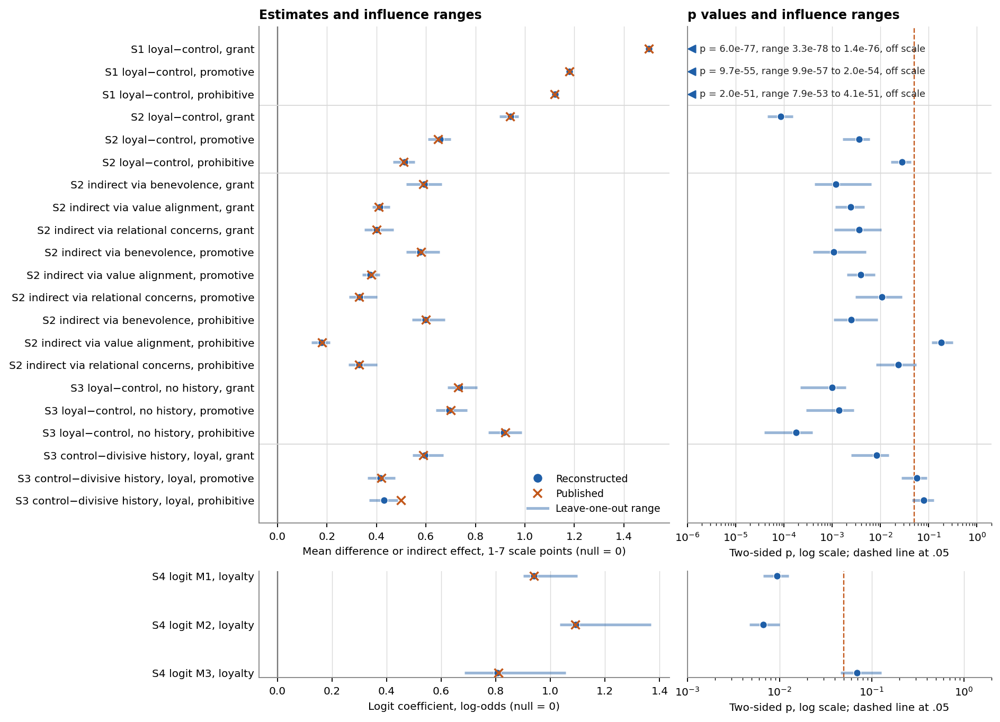

# Replication report: Berry and Hildreth (2025)

Berry, Z., and Hildreth, J. A. D. (2025). When Your Friend is My Friend. Organization Science 36(2), 762-785. Deposit: https://osf.io/3h6vc. Data and article are not rehosted here. Scope: main-text Studies 1-4, with their Online Appendix results. Studies S1-S7 are out of scope. This report stands apart from the v4 studies and enters none of their counts.

## Findings

The workflow rebuilt the paper's focal results from the written methods and the deposited data alone. All 22 focal claims scored consistent under the frozen rules, so the paper-level outcome is consistent. For comparability, the frozen map gives fully reproduced, with the qualification on Study 2 below. The three implementations agreed on every non-bootstrap number at the focal level. The deposited data were processed by the authors before deposit, so this study does not test reconstruction of raw sources.

The more useful finding is what the written methods got wrong. The article says the indirect effects use 95 percent bias-corrected bootstrap intervals, and the preregistration says 5,000 resamples. The author script does not bootstrap. It passes `bootstrap = 5000` to lavaan without `se = "bootstrap"`, so lavaan returns normal-theory standard errors and symmetric intervals. Running the bootstrap the article describes gave standard errors 1.10 to 1.56 times the printed ones. Every interval kept the same side of zero as printed, across 16 of 16 Study 2 and Study 4 indirect effects, so no conclusion changes. The printed SEs and intervals do not come from the method the article names.

Consistent here therefore means the point estimate, sign and zero-exclusion match. For the nine Study 2 focal indirect effects it does not mean the printed SE or interval was reproduced from the written method. The frozen rules did not require that, and an audit flagged it.

The only discrepant candidate was outside the focal set, and adversarial review overturned it. It was the Online Appendix serial model through relational concerns, published at 0.71 against 0.149 reconstructed. The author script gets 0.712 from a restricted model with two residual covariances that no document mentions. Neither the frozen reading nor any written reading reaches that number. The frozen score stays as recorded, and the disposition is indeterminate, underdocumentation. No human reviewed any finding: the user removed that stage during the study, before any result was opened.

The memorization probes gave no sign of recall. Fable 5.1 recognized the authors' research program weakly and gave no study count or numbers. GPT-6 Astra recalled nothing. That does not prove the models did not recall the paper, but neither named a result.

## What was reconstructed and how

All four main-text studies were attempted and none was unavailable. Implementers received neutral files named dataset_1 to dataset_4, built by code from the deposit with no row filtered and free-text columns removed: 7 from Study 1, 5 each from Studies 2 and 3, none from Study 4. They developed on synthetic data, and the coordinator ran the frozen scripts on the real files with the network denied.

The deposit carries no dictionary for the Study 4 file. The file filed there is the Study S4 dictionary and shares no variable names with the Study 4 columns, so all Study 4 mappings are inferred. Three Study 3 columns are missing from its dictionary. The inferred attention filters removed nobody, because the deposit was already filtered, and every sample level gave the published N: 530, 186, 286 and 50.

## Comparison 1: AI reconstruction against published results

This is the protocol outcome, scored by frozen code. The frozen N rule kept the origin sample in all four studies.

{FOCAL}

SE units are distances from the rounding interval of the published estimate. For t tests and contrasts the published SE is derived from printed means and t, a declared adaptation. For indirect effects the reconstructed p is the delta-method p from the frozen specification, and the inference test is zero exclusion of the bias-corrected interval.

All {claims_n} claim records by tier:

{TIERS}

Family outcomes are consistent for H1 (10 claims), H2 (9) and H3 (3). Reader-disputed tiers are counted as uncertain and non-focal. One reader marked the Study 4 overview table's mediation tick as focal. It has no estimate to score, and if it were counted as indeterminate focal evidence the paper outcome would become indeterminate under the frozen rule. Both results are reported.

The closest focal call is the Study 3 prohibitive H3 contrast, at 0.21 SE units against a 0.25 limit. It comes from a printed mean of 2.12 where the data give 2.19.

Of 483 parseable printed statistics compared under the origin method, 440 matched at printed precision. The eight indeterminate records are five descriptive tables and two reliability tables with mismatched cells, plus one Study 2 serial model. Adversarial review traced the mismatches it examined to the published record:

| Printed | Data | Reading |
| --- | --- | --- |
| Table 2 promotive mean 3.88 | 2.88 | Typo; exceeds both printed condition means |
| Study 2 promotive loyal SD 1.95 | 1.69 | Typo; printed t, df and d fit 1.69 |
| Study 3 promotive eta squared .048 | .036 to .037 | Printed error, probably copied from the granting line |
| Study 3 prohibitive SD 1.74 | 1.93 | Internal inconsistency; printed d fits 1.93 |
| Study 3 prohibitive mean 2.12 | 2.19 | Typo; printed t and d fit 2.19 |
| Online Appendix dishonesty t 1.61 | 1.16 | Transposed digits; printed p fits 1.16 |
| Study 1 interaction p .944 | .994 | Transposed digits; F implies .993 to .995 |
| Study 1 prohibitive t 16.76 | 16.87 | Cause undecided; the author script also gives 16.87 |

The frozen scorer gave no claim outcome to the gender subgroup tables (96 of 484 target statistics). This is a scorer gap, reported rather than repaired. Their printed t values match Student and Welch tests on stacked rows, not the paired origin the grid set.

## Comparison 2: author script rerun against published results

The script does not run as deposited. On a copy of the data with the network denied, 31 of 164 expressions failed, after installing packages it needs. It calls columns the deposit does not have (PROLIFIC_PID, reputation_with_broker), uses `PseudoR2` from a package it never loads, and uses a `: =` syntax that lavaan 0.6-21 rejects. With four recorded text changes, all 164 ran. Package versions and changes are in runs/author_rerun/.

It then matched 222 of 232 published statistics it computes, at printed precision, including every indirect-effect estimate, SE and p apart from small rounding cases. Four of the ten misses are the published-record items above, and the other six are last-digit rounding differences. The script covers only 171 of 484 target statistics: it holds no descriptive tables, reliabilities or gender analyses, so those cannot be traced to author code.

## Comparison 3: AI code against author code

Effects come from post-unsealing diagnostics, one difference at a time. These are restatements of the frozen specification checked against frozen outputs, not patched copies of the implementers' scripts. No frozen result, label or score was changed.

| Difference | AI | Author | Written source | Changes a result? |
| --- | --- | --- | --- | --- |
| Sample filters | Inferred attention keys | None; deposit already filtered | Rules stated, keys inferred from dictionary | No: identical samples |
| Scale construction | Item means | Deposited columns | Dictionary writes sums; data hold means | No: 0 differing values |
| Condition coding and contrast direction | Recodes and cells | Same | Dictionary and article | No |
| Study 1 pairing | By person ID | By row position | Stated nowhere | No: file order aligns |
| Paired d | Condition-SD formula | effsize paired | Stated nowhere | Yes, third digit: AI matched 11 of 21 printed d, author 20 of 20 covered |
| Study 3 d | Condition-SD average | Pooled SD | Stated nowhere | Yes, third digit: pooled matches 14 of 14 |
| Eta squared | Type III | Type II through etasq | Stated nowhere | Yes, third digit: 15 versus 19 of 21 |
| Indirect-effect SE and interval | Bias-corrected bootstrap, 5,000 | Normal-theory, no bootstrap | Article states the AI's method; code contradicts it | Yes: SEs 1.10 to 1.56 times printed; zero exclusion same in 16 of 16 |
| Delta p for indirect effects | OLS SEs | lavaan model SEs, with no mediator residual covariances | Stated nowhere | Yes: prohibitive value alignment .180 against .066; both non-significant |
| Serial models | Saturated paths | Restricted chain with residual covariances | Stated nowhere; saturated form was an AI choice | Yes: 0.149 against 0.712 and 0.389 against 0.469 |
| Study 4 mediation | Linear outcome, bootstrap | Linear outcome, no bootstrap | Article says same technique | Point estimates no; intervals yes |
| Welch t, pooled contrast error, logit | Same | Same | Inferred by readers from printed df | No |
| Gender subgroup test type | Paired origin | No code | Stated nowhere | Cannot compare; printed values fit independent tests |

No difference was classified as a plain AI misreading of a clear written statement. The saturated serial form and the paired gender origin are AI choices where the documents were silent, and the grid should have carried alternatives for them.

## One example from text to score

Take Study 3, prohibitive voice, divisive history among loyal participants. The article reports a planned contrast and prints t(282) = 1.77, p = .079. Both readers mapped it to the H3 test and marked it focal. The printed df led Fable 5.1 to infer the full-model error term, while the preregistration wording suggested a two-cell t, so the grid froze the pooled contrast as origin and the two-cell tests as uncertain. The manifest told implementers to compute LC minus LD with df = N - 4, without any target. All three returned t = 1.766, p = .0785. The scorer compared it with sealed targets: same sign, same p band, 0.21 SE units, so consistent. The two-cell alternatives gave p = .117 to .120, also non-significant. The author script's emmeans contrast gives the same 1.77.

## Model settings and influence refits

Each implementation produced {quantities} quantities across {settings_all} analysis settings. Of those settings, {settings_origin_sample} remain at one sample per study, because alternative filter levels were identical to origin samples, and {settings_origin_sample_composite} remain at one composite level, because deposited composites equal item means and item sums are algebraic rescalings for test statistics. Repeat implementations are checks, not extra specifications.

- Equivalent alternatives: Welch and Student t in Study 2; bias-corrected and percentile intervals; deposited composite columns. All stayed on the same side of alpha or zero. Fragility was assessed only for these Study 2 claims and Study 4 mediation, and not assessed for Study 1, Study 3 or Study 4 Model 1, which had no equivalent alternative.
- Uncertain alternatives: within-effect ANOVA and mixed models in Study 1 (all p < .001); two-cell contrasts in Study 3 (no focal side change at .05); Type II sums of squares; sandwich SEs and logistic or dichotomous mediation in Study 4.
- Non-equivalent alternatives: single-mediator models, Type I sums of squares, Study 4 strong and exponential loyalty and house loyalty as predictor.
- Label-sensitive claims, none focal: if uncertain levels counted as equivalent, Study 4 Model 3 loyalty (p = .070, sandwich p = .024), three Study 4 covariate terms and the two trust mediation claims would score fragile, against consistent as frozen. Both are preserved without a choice between them.

Influence: {influence_rows} leave-one-out rows per implementation, {influence_scoring_samples} at scoring samples and the rest duplicates on identical samples, with {influence_failed} failures.

## Reader agreement, decisions and configuration

Initial agreement, before any clarification, none being requested: tier labels 47 of 60 shared claim groups, Gwet's AC1 0.74; equivalence labels 3 of 12 shared levels, AC1 -0.12, with 44 of 56 levels proposed by only one reader. Transcription is a separate measure: all 472 statistics both readers transcribed agree. Disagreeing labels became uncertain and structures were kept as a union. The coordinator set origin levels where readers differed, and logged them in reconciliation/ and manifest/frozen_grid_v1.json.

Executed configuration: coordinator Claude Opus 5.5, High, fast mode off. Reader A and implementer A Claude Fable 5.1, High, standard tier, confirmed from CLI metadata. Reader B and implementers B and C GPT-6 Astra, High, default tier as requested; the Codex event stream reports no model, effort or tier, so these are unverified by metadata, and the global AGENTS.md did load. Checkers came from the other family. The coordinator and Reader A share a family. Implementation agreement across all quantities: {age_all_agree} of {quantities} unanimous, {age_pair_AB} and {age_pair_AC} on a pair, {age_partial} partial, {age_no_pair} with no pair. All non-unanimous rows are in Study 4: Model 3 numerics in implementer C and bootstraps of near-separated logistic alternatives, none at a focal estimate.

Verification limits: an audit found no transcription, lineage or calculation error, and 14 places where the scorer departs from its rules. As far as tested, none changes a focal, family or paper outcome; only a tolerance fix was rerun, and the rest rest on reading the code path. The adversarial pass used Claude Opus 5.5, so no model family independent of both implementation families reviewed it, and no finding is called fully verified. Astra roles had an enforced write and network barrier but no enforced read barrier; their command logs showed no outside access. Fable roles had an enforced read barrier and restricted commands. Network denial for empirical runs was enforced and tested.

## Figure

Effect scale and null: mean differences and indirect effects in 1-7 scale points, logit coefficients in log-odds, null 0 in each. Crosses are published estimates, dots reconstructed ones, lines the full leave-one-out range. p values are two-sided, with paired t, Welch t, delta z, pooled contrast t or Wald z according to the row, and the dashed line is the .05 threshold. Study 1 p values fall below the axis and are printed in the panel, not discarded. Deleted units are persons in Study 1 and rows elsewhere. N is 530, 186, 286 and 50, 5,688 deletions in all with no failures. Missing data are handled by complete cases. Data are the author-processed OSF deposit, with measures rebuilt from items where items exist.

Deletion ranges are influence ranges, not confidence intervals, and they are not equivalent specifications. The figure supports the claim that no single participant drives the reconstructed estimates. It cannot establish a fragile verdict. Single deletions do cross .05 for Study 2 prohibitive via relational concerns (delta p up to .055), Study 3 H3 on promotive and prohibitive voice (down to .028 and .046), and Study 4 Model 3 (down to .046). The first of these rests on a delta p, not on the frozen bootstrap interval.

## Supplements

Packet frozen_v1, identical for both readers: D01 article; D02 AppendixA materials; D03 Online Appendix; D11-D14 preregistrations; D22 Study 2 deviation report; D31-D34 dictionaries; D41-D44 column names. Text forms were mechanical conversions and pages come from the PDFs. No document was added after initial reading. Studies S1-S7 in D03 were excluded. Contradictions preserved: dictionaries write composites as sums while data and article use means; preregistered months against article semesters in Study 4; Loyal vs. Not Loyal wording in D03 against a continuous measure; Table 1's Study 4 mediation tick; printed serial intervals that are actually standardized coefficients.

## Limits

- One paper from authors who shared voluntarily, with preregistrations and dictionaries. It was received August 1, 2023, before the journal's data rules for submissions from August 1, 2025, and it is likely a favorable case.
- Author-processed data remove the sample-reconstruction problem that drives many gaps in public-source cases.
- A match does not establish that models did not recall the paper.
- The result does not generalize to experiments as a class.
- The coordinator wrote the manifest after seeing targets and deposit row counts. A leak scan found no target value in it, and it holds no article identity, but this contact was not blind. Some origin choices came from readers' inferences from printed df, which is a document source and not a data one.
- All constants are provisional and uncalibrated on real papers. Synthetic rule tests passed 7 of 7; synthetic checks do not measure false-flag rates. Null-data, post-cutoff, human-reproduced and human double-coding arms were not performed.
- No human reviewed labels, audits or the adversarial disposition.

Details: [technical_supplement.md](technical_supplement.md), [audit_pre_unseal.md](audit_pre_unseal.md), [adversarial_review.md](adversarial_review.md), [exports/](exports/).
